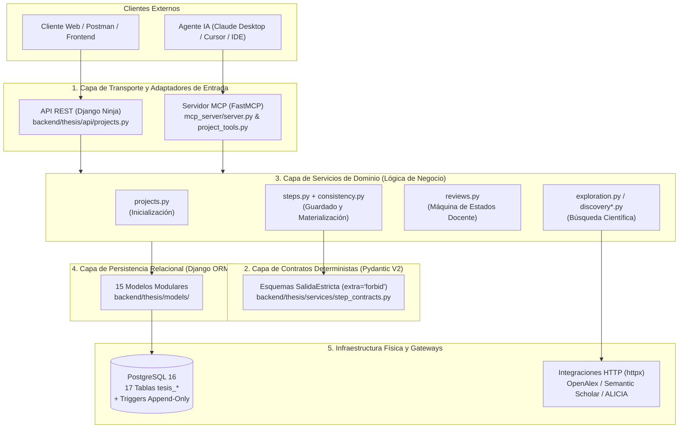
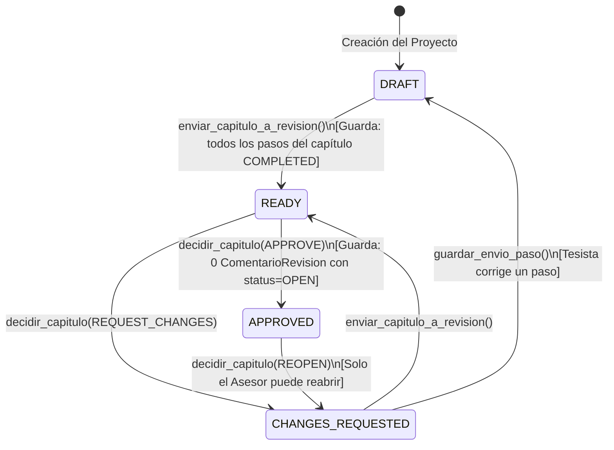

# 01. Arquitectura en Capas y Patrones de Diseño (`version_reducida_docente`)

Este documento explica cómo está estructurada la ingeniería interna de `version_reducida_docente/`. Aunque el alcance funcional está acotado a los **Capítulos 1 al 3 (`P01` a `P12`)**, la arquitectura aplica separación estricta de responsabilidades (*Separation of Concerns*) y patrones clásicos de diseño de software.

---

## 1. Diagrama General de Arquitectura en 5 Capas

El sistema sigue una **Arquitectura Limpia / En Capas (*Layered Architecture*)** con **Doble Puerta de Entrada (API REST + Protocolo MCP)**. Ningún controlador web ni herramienta MCP escribe directamente en la base de datos: ambos convergen en la misma **Capa de Servicios de Dominio**.



---

## 2. Los 7 Patrones de Diseño Implementados en el Código

### Patrón 1: *Service Layer Pattern* (Capa de Servicios Desacoplada del Transporte)
* **Archivos clave:** [`backend/thesis/api/projects.py`](../backend/thesis/api/projects.py) y [`mcp_server/project_tools.py`](../mcp_server/project_tools.py) delegan en [`backend/thesis/services/`](../backend/thesis/services/).
* **Por qué se usa:** En proyectos básicos de Django, los desarrolladores suelen meter la lógica de negocio dentro de las vistas (`views.py`) o dentro del método `save()` del modelo. Si haces eso, cuando quieres conectar un servidor MCP además de una API REST, tendrías que duplicar todas las validaciones.
* **Cómo funciona aquí:**
  * Tanto el endpoint HTTP `POST /api/projects/{id}/steps/{step_code}` en [`api/projects.py`](../backend/thesis/api/projects.py) como la herramienta MCP `guardar_paso` en [`project_tools.py`](../mcp_server/project_tools.py) llaman exactamente a la misma función de servicio: `guardar_envio_paso(...)` en [`services/steps.py`](../backend/thesis/services/steps.py).

---

### Patrón 2: *Registry & Strategy Pattern* (Despacho Polimórfico de Contratos)
* **Archivos clave:** [`backend/thesis/step_catalogue.py`](../backend/thesis/step_catalogue.py) y [`backend/thesis/services/step_contracts.py`](../backend/thesis/services/step_contracts.py).
* **Por qué se usa:** Cada uno de los 12 pasos metodológicos (`P01` a `P12`) tiene una estructura JSON completamente distinta. Usar una cadena gigante de `if codigo_paso == "P01": ... elif codigo_paso == "P02": ...` violaría el principio Abierto/Cerrado (*Open/Closed Principle*).
* **Cómo funciona aquí:**
  1. Todos los esquemas heredan de [`SalidaEstricta`](../backend/thesis/services/step_contracts.py) que configura `model_config = ConfigDict(extra="forbid")`, rechazando cualquier campo inventado o alucinado por el LLM.
  2. El diccionario [`CONTRATOS`](../backend/thesis/services/step_contracts.py) actúa como un **Registro de Estrategias** (`dict[str, type[BaseModel]]`):
     ```python
     CONTRATOS: dict[str, type[BaseModel]] = {
         "P01": SalidaP01,
         "P02": SalidaP02,
         # ... hasta P12
         "P12": SalidaP12,
     }
     ```
  3. La función [`validar_carga_paso(codigo_paso, carga)`](../backend/thesis/services/step_contracts.py) busca el esquema en $O(1)$ y ejecuta `esquema.model_validate(carga)`. Si alguien intenta enviar `P13` (Capítulo 4), el registro lo rechaza inmediatamente con `ErrorValidacion`.

---

### Patrón 3: *Unit of Work & Materializer Pattern* (Normalización Transaccional)
* **Archivos clave:** [`backend/thesis/services/steps.py`](../backend/thesis/services/steps.py) y [`backend/thesis/services/step_materializers/consistency.py`](../backend/thesis/services/step_materializers/consistency.py).
* **Por qué se usa:** Cuando el agente IA envía la respuesta de un paso (por ejemplo, `P11` con las variables independiente y dependiente, o `P12` con las dimensiones e indicadores), guardar únicamente un blob JSON impediría hacer consultas relacionales o garantizar integridad referencial entre objetivos, variables e indicadores.
* **Cómo funciona aquí:**
  1. `guardar_envio_paso()` abre un bloque atómico `with transaction.atomic():` (*Unit of Work*): o se guardan todos los cambios en todas las tablas o se hace `ROLLBACK` completo.
  2. Primero guarda el payload validado en `ProgresoPaso`.
  3. Luego invoca a [`aplicar_materializaciones_paso()`](../backend/thesis/services/step_materializers/consistency.py), que traduce el JSON validado a filas relacionales reales en PostgreSQL:
     * En `P01`–`P08`: actualiza columnas específicas de `PerfilInvestigacion`.
     * En `P09`–`P10`: construye o actualiza las filas de `FilaConsistencia` (Matriz de Consistencia: fila `GENERAL` y filas `SPECIFIC`).
     * En `P11`: crea las entidades `VariableInvestigacion` (`VI` y `VD`) y las vincula mediante la tabla puente `VariableFilaConsistencia`.
     * En `P12`: descompone cada variable en `DimensionVariable` e `Indicador` (fórmula, unidad de medida, escala e instrumento).
  4. Finalmente, [`renderizar_markdown_capitulo()`](../backend/thesis/services/step_materializers/consistency.py) compila un documento Markdown legible de todo el capítulo y crea una nueva versión inmutable en `RevisionCapitulo`.

---

### Patrón 4: *Optimistic Concurrency Control — OCC* (Control de Concurrencia Optimista + Bloqueo Pesimista de Fila)
* **Archivos clave:** [`backend/thesis/models/projects.py`](../backend/thesis/models/projects.py) y [`backend/thesis/services/steps.py`](../backend/thesis/services/steps.py).
* **Por qué se usa:** Si un tesista tiene abierto su cliente MCP en el IDE y al mismo tiempo otra pestaña o petición intenta guardar un paso sobre el mismo proyecto, una petición podría pisar los datos de la otra (*Lost Update Problem*).
* **Cómo funciona aquí:**
  1. Dentro de la transacción, se bloquea la fila del proyecto en PostgreSQL con `Proyecto.objects.select_for_update().get(id=id_proyecto)`.
  2. Se compara la versión enviada por el cliente (`version_esperada`) contra `proyecto.lock_version`:
     ```python
     if proyecto.lock_version != version_esperada:
         raise ErrorConflicto(
             "Versión desactualizada del proyecto",
             code="STALE_VERSION",
             details={"expected_version": version_esperada, "current_version": proyecto.lock_version},
         )
     ```
  3. Si coincide, al finalizar la materialización se incrementa `proyecto.lock_version += 1`.

---

### Patrón 5: *Append-Only Audit Log + Database Triggers* (Inmutabilidad en Defensa en Profundidad)
* **Archivos clave:** [`backend/thesis/models/chapters.py`](../backend/thesis/models/chapters.py) y [`backend/thesis/migrations/0002_inmutabilidad_espanol.py`](../backend/thesis/migrations/0002_inmutabilidad_espanol.py).
* **Por qué se usa:** En un sistema académico donde el asesor evalúa entregas del tesista, el historial de entregas (`RevisionCapitulo`) y el registro de decisiones (`EventoRevision`) **no pueden ser alterados ni borrados retroactivamente**.
* **Cómo funciona aquí (Doble Barrera):**
  1. **Barrera en Aplicación (Python ORM):** Los modelos `RevisionCapitulo` y `EventoRevision` sobrescriben `.save()` y `.delete()` para lanzar `ValidationError("... son de solo anexado")` si el registro ya existe (`not self._state.adding`).
  2. **Barrera en Motor de Base de Datos (PostgreSQL PL/pgSQL):** Incluso si alguien se salta el ORM usando `QuerySet.update()` o SQL directo, la migración `0002_inmutabilidad_espanol.py` instala la función `tesis_rechazar_cambio_historial()` y los disparadores `tesis_revision_capitulo_solo_anexar` y `tesis_evento_revision_solo_anexar` (`BEFORE UPDATE OR DELETE`), abortando la operación en el propio motor PostgreSQL.

---

### Patrón 6: *State Machine con Guardas de Dominio* (Flujo de Revisión Docente)
* **Archivo clave:** [`backend/thesis/services/reviews.py`](../backend/thesis/services/reviews.py).
* **Por qué se usa:** Un capítulo no puede aprobarse si está incompleto o si tiene correcciones pendientes, y un tesista no debe modificar un capítulo que ya fue aprobado oficialmente por su asesor.
* **Diagrama de Máquina de Estados (`Capitulo.status`):**



---

### Patrón 7: *Context Hydration Pattern* (Hidratación Dinámica de Prompts MCP)
* **Archivos clave:** [`mcp_server/prompts/catalog.py`](../mcp_server/prompts/catalog.py) y [`mcp_server/prompts/hydration.py`](../mcp_server/prompts/hydration.py).
* **Por qué se usa:** Los prompts estáticos fallan porque el LLM olvida lo que el estudiante definió en pasos anteriores (por ejemplo, al redactar las hipótesis en `P10`, el LLM necesita conocer exactamente el título de `P04`, el alcance de `P05` y la pregunta general de `P07`).
* **Cómo funciona aquí:** Cuando el cliente MCP solicita cualquiera de los 12 prompts metodológicos pasándole el `project_id`, la función [`hidratar_contexto_proyecto(id_proyecto)`](../mcp_server/prompts/hydration.py) consulta `PerfilInvestigacion`, `ProgresoPaso`, `FilaConsistencia` y `VariableInvestigacion` en PostgreSQL y construye un bloque Markdown con el estado real confirmado hasta ese instante, inyectándolo automáticamente dentro del prompt antes de enviarlo al LLM.
