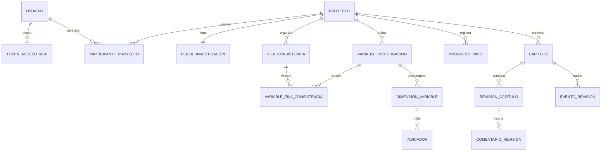

# 02. Modelo de Datos y Esquema Físico en Español (`15 modelos` / `17 tablas`)

El avance evolutivo V1 utiliza exclusivamente PostgreSQL. Los modelos están definidos en [`backend/thesis/models/`](../backend/thesis/models/) y se crean mediante tres migraciones en [`backend/thesis/migrations/`](../backend/thesis/migrations/).

## 1. Relaciones principales

`PerfilInvestigacion.version_bloqueo` contiene la versión usada para concurrencia optimista. Los capítulos y progresos no se crean anticipadamente: aparecen conforme el tesista ejecuta los pasos.

El diseño y modelado de datos se estructura formalmente en tres niveles disponibles en `docs/diagramas/`:
* **Modelo Conceptual (ER):** Entidades sustantivas y relaciones semánticas de negocio. Ver [`05_modelo_conceptual_er.png`](./diagramas/05_modelo_conceptual_er.png).
* **Modelo Lógico Relacional (3NF):** Normalización en tercera forma normal, resolución de cardinalidades $N:M$ y claves foráneas. Ver [`06_modelo_logico_relacional.png`](./diagramas/06_modelo_logico_relacional.png).
* **Modelo Físico Oficial (17 Tablas):** Esquema implementado en PostgreSQL 16 con prefijo `tesis_` y triggers de inmutabilidad. Ver [`07_der_modelo_fisico_17_tablas.png`](./diagramas/07_der_modelo_fisico_17_tablas.png).

## 2. Catálogo literal de tablas propias

Las 17 tablas con prefijo `tesis_` corresponden a 15 modelos Django y 2 tablas intermedias de autorización.

### Cuentas y seguridad

1. **`tesis_usuario` (`Usuario`)**: usuario autenticable por `correo`; hereda los campos de autorización de Django.
2. **`tesis_usuario_grupo`**: relación M2M entre `usuario_id` y `grupo_id`.
3. **`tesis_usuario_permiso`**: relación M2M entre `usuario_id` y `permiso_id`.
4. **`tesis_token_acceso_mcp` (`TokenAccesoMcp`)**: conserva `hash_token`, usuario, expiración, revocación y fecha de creación. Nunca persiste el token en texto plano.

### Proyectos

5. **`tesis_proyecto` (`Proyecto`)**: UUID, nombre, título, estado (`ACTIVO` o `ARCHIVADO`) y marcas temporales.
6. **`tesis_participante_proyecto` (`ParticipanteProyecto`)**: relaciona proyecto y usuario con rol interno `OWNER` o `ADVISOR`. Las restricciones `tesis_participante_un_propietario_activo` y `tesis_participante_un_asesor_activo` permiten uno activo de cada rol por proyecto.

### Formulación metodológica

7. **`tesis_perfil_investigacion` (`PerfilInvestigacion`)**: relación 1:1 con proyecto; almacena enfoque, tema, ODS, unidad de análisis, lugar, periodo, planteamiento, versión de esquema y versión de bloqueo.
8. **`tesis_fila_consistencia` (`FilaConsistencia`)**: usa `orden=0` para la fila general y `1..N` para las específicas; almacena pregunta, objetivo e hipótesis.
9. **`tesis_variable_investigacion` (`VariableInvestigacion`)**: variable `INDEPENDENT`, `DEPENDENT` u `OTHER`, con nombre, definiciones y orden.
10. **`tesis_variable_fila_consistencia` (`VariableFilaConsistencia`)**: tabla puente explícita entre filas y variables.
11. **`tesis_dimension_variable` (`DimensionVariable`)**: dimensiones ordenadas de una variable, con nombre y definición opcional.
12. **`tesis_indicador` (`Indicador`)**: indicadores ordenados con nombre, escala de medición, técnica y regla operacional opcionales. En el flujo P12 actual se materializan nombre y escala.

### Progreso y revisión docente

13. **`tesis_progreso_paso` (`ProgresoPaso`)**: código de paso, estado `EN_CURSO` o `COMPLETADO`, `salida_json` y fechas.
14. **`tesis_capitulo` (`Capitulo`)**: número restringido a 1..3, estado de revisión y referencia a la revisión aprobada.
15. **`tesis_revision_capitulo` (`RevisionCapitulo`)**: historial append-only con número, paso, UUID de idempotencia, Markdown, SHA-256, autor y fecha.
16. **`tesis_comentario_revision` (`ComentarioRevision`)**: observación anclada mediante `inicio_caracter`, `fin_caracter` y `texto_seleccionado`; el rango debe ser positivo.
17. **`tesis_evento_revision` (`EventoRevision`)**: registra `ENVIAR`, `SOLICITAR_CAMBIOS`, `APROBAR` o `REABRIR`, junto con capítulo, revisión, actor, motivo y fecha.

## 3. Traducción física al español

Las clases internas conservan nombres ingleses para mantener la identidad de las migraciones y la compatibilidad con Django. [`models/__init__.py`](../backend/thesis/models/__init__.py) expone alias como `Proyecto`, `PerfilInvestigacion` y `Capitulo`, y `COLUMNAS_FISICAS` asigna los nombres SQL españoles mediante `db_column`.

- [`0001_inicial.py`](../backend/thesis/migrations/0001_inicial.py) crea los 15 modelos y sus restricciones.
- [`0002_integridad_esquema.py`](../backend/thesis/migrations/0002_integridad_esquema.py) establece las tablas M2M, las restricciones, los índices y la función `tesis_rechazar_cambio_historial()`.
- [`0003_normalizacion_estados.py`](../backend/thesis/migrations/0003_normalizacion_estados.py) normaliza de forma reversible los estados, roles y acciones persistidos, y actualiza las restricciones que dependen de esos valores.
- Los triggers `tesis_revision_capitulo_solo_anexar` y `tesis_evento_revision_solo_anexar` bloquean `UPDATE` y `DELETE` en PostgreSQL.

La puerta [`scripts/verify_project.py`](../scripts/verify_project.py) compara las 17 tablas y todas sus columnas con el ORM, comprueba nombres de restricciones e índices y exige la presencia exacta de la función y ambos triggers.
