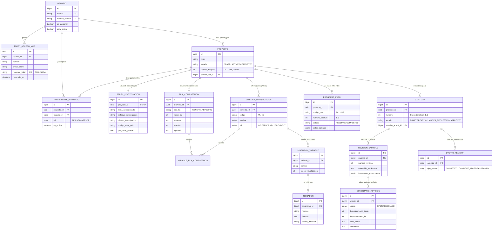

# 02. Modelo de Datos y Esquema Físico en Español (`15 Modelos` / `17 Tablas`)

Este documento detalla cómo está diseñada la base de datos PostgreSQL (`tesismcp_reducido_docente`) en [`backend/thesis/models/`](../backend/thesis/models/) y sus migraciones en [`backend/thesis/migrations/`](../backend/thesis/migrations/).

---

## 1. Diagrama Entidad-Relación (`erDiagram`) de las 15 Entidades de Dominio

---

## 2. Catálogo Completo de las 17 Tablas Físicas en PostgreSQL

Las 17 tablas propias del dominio utilizan el prefijo `tesis_`. Se dividen en **15 tablas de modelos Django** y **2 tablas intermedias (`ManyToMany`) de permisos de usuario**:

### A. Módulo de Cuentas y Seguridad MCP ([`models/accounts.py`](../backend/thesis/models/accounts.py))
1. **`tesis_usuario` (`Usuario`)**: Extiende `AbstractUser` de Django usando `email` (`correo`) como identificador único (`USERNAME_FIELD = "email"`).
2. **`tesis_usuario_grupo` *(Tabla intermedia M2M)***: Relaciona `usuario_id` con `grupo_id`.
3. **`tesis_usuario_permiso` *(Tabla intermedia M2M)***: Relaciona `usuario_id` con `permiso_id`.
4. **`tesis_token_acceso_mcp` (`TokenAccesoMcp`)**: Almacena tokens de acceso personal para el servidor MCP. **Nunca guarda el token en texto plano**: solo almacena los primeros 12 caracteres en `prefijo_clave` y el hash SHA-256 de 64 caracteres hexadecimales en `resumen_token` (`token_digest`).

### B. Módulo de Proyectos y Roles ([`models/projects.py`](../backend/thesis/models/projects.py))
5. **`tesis_proyecto` (`Proyecto`)**: Entidad raíz identificada por UUID. Incluye `version_bloqueo` (`lock_version`) para control de concurrencia optimista.
6. **`tesis_participante_proyecto` (`ParticipanteProyecto`)**: Define quién es `TESISTA` y quién es `ASESOR` en un proyecto. Incluye una **restricción de unicidad parcial en PostgreSQL** (`tesis_participante_unico_asesor_activo_idx`): un proyecto solo puede tener **un único asesor activo** a la vez (`condition=Q(role="ASESOR", is_active=True)`).

### C. Módulo de Investigación Científica — Capítulos 1 al 3 ([`models/research.py`](../backend/thesis/models/research.py))
7. **`tesis_perfil_investigacion` (`PerfilInvestigacion`)**: Relación `1:1` con `Proyecto`. Almacena toda la formulación de los Capítulos 1 y 2 (`P01` a `P08`): ` Opciones de tema`, `tema_seleccionado`, `enfoque_investigacion`, `alcance_investigacion`, `diseno_investigacion`, `poblacion`, `tamano_muestra`, `codigo_meta_ods`, `resumen_planteamiento_problema` (`CA-S-P-CO-CC-PC`), `pregunta_general` y `resumen_justificacion`.
8. **`tesis_fila_consistencia` (`FilaConsistencia`)**: Materializa la **Matriz de Consistencia** (`P09` y `P10`). La fila con `indice_fila = 0` es `GENERAL` (pregunta general, objetivo general, hipótesis general y nula) y las filas `1..N` son `SPECIFIC` (preguntas específicas, objetivos específicos e hipótesis específicas).
9. **`tesis_variable_investigacion` (`VariableInvestigacion`)**: Materializa `P11`. Representa las variables `VI` (`INDEPENDENT`), `VD` (`DEPENDENT`) o `INTERVENING`, con su definición conceptual y operacional.
10. **`tesis_variable_fila_consistencia` (`VariableFilaConsistencia`)**: Tabla puente explícita entre `FilaConsistencia` y `VariableInvestigacion`.
11. **`tesis_dimension_variable` (`DimensionVariable`)**: Materializa `P12`. Divide cada variable en dimensiones ordenadas (`orden_visualizacion`).
12. **`tesis_indicador` (`Indicador`)**: Materializa `P12`. Almacena para cada dimensión su `nombre`, `formula`, `unidad_medida`, `escala_medicion` e `instrumento_recoleccion`.

### D. Módulo de Progreso, Capítulos y Revisión Docente ([`models/chapters.py`](../backend/thesis/models/chapters.py))
13. **`tesis_progreso_paso` (`ProgresoPaso`)**: Registra el estado (`PENDING`, `IN_PROGRESS`, `COMPLETED`) y el JSON validado (`datos_actuales`) de cada uno de los 12 pasos (`P01` a `P12`).
14. **`tesis_capitulo` (`Capitulo`)**: Representa los Capítulos 1, 2 y 3 del proyecto. Posee un `CheckConstraint` físico en PostgreSQL (`tesis_capitulo_numero_rango`) que **prohíbe insertar capítulos fuera del rango `1 <= numero <= 3`**.
15. **`tesis_revision_capitulo` (`RevisionCapitulo`)**: Instantánea inmutable (*append-only*) creada cada vez que el tesista guarda un paso. Almacena el `contenido_markdown` compilado y la `instantanea_estructurada`.
16. **`tesis_comentario_revision` (`ComentarioRevision`)**: Observaciones del asesor ancladas a una posición exacta del texto (`desplazamiento_inicio`, `desplazamiento_fin`, `texto_citado`). Tiene un `CheckConstraint` (`tesis_comentario_rango_anclaje`) que garantiza `end_offset > start_offset`.
17. **`tesis_evento_revision` (`EventoRevision`)**: Bitácora de auditoría inmutable (*append-only*) que registra cada envío a revisión, observación agregada, resolución de comentario o decisión del asesor (`SUBMITTED`, `COMMENT_ADDED`, `COMMENT_RESOLVED`, `CHANGES_REQUESTED`, `APPROVED`, `REOPENED`).

---

## 3. Cómo Funciona la Traducción Física al Español (`models/__init__.py` + Migraciones)

En [`backend/thesis/models/__init__.py`](../backend/thesis/models/__init__.py) verás una técnica de metaprogramación limpia sobre el `_meta` de Django:

1. **Separación entre API interna de Django y Esquema Físico SQL:**
   * Django internamente espera que `AbstractUser` tenga atributos en inglés como `is_staff`, `is_active`, `date_joined` o `groups`. Si cambias el nombre del atributo Python en `AbstractUser`, rompes el panel `/admin/` y el middleware de autenticación de Django.
   * Para evitar romper Django y al mismo tiempo tener una base de datos 100 % en español, el diccionario `_COLUMNAS_ESPANOL` en [`models/__init__.py`](../backend/thesis/models/__init__.py) asigna `field.db_column = nombre_espanol` a cada campo de los 15 modelos en tiempo de carga de la clase.
2. **Consolidación en 2 Migraciones Limpias:**
   * [`0001_inicial.py`](../backend/thesis/migrations/0001_inicial.py): Crea las 15 entidades con sus nombres de tabla (`db_table = "tesis_..."`) y columnas (`db_column`) directamente en español.
   * [`0002_inmutabilidad_espanol.py`](../backend/thesis/migrations/0002_inmutabilidad_espanol.py):
     * Renombra las columnas autogeneradas por Django en las tablas M2M (`user_id` $\rightarrow$ `usuario_id`, `group_id` $\rightarrow$ `grupo_id`, `permission_id` $\rightarrow$ `permiso_id`).
     * Renombra todas las restricciones (`PK`, `FK`, `UNIQUE`, `CHECK`) e índices de PostgreSQL al prefijo `tesis_*`.
     * Crea la función PL/pgSQL `tesis_rechazar_cambio_historial()` y los disparadores `tesis_revision_capitulo_solo_anexar` y `tesis_evento_revision_solo_anexar`.
