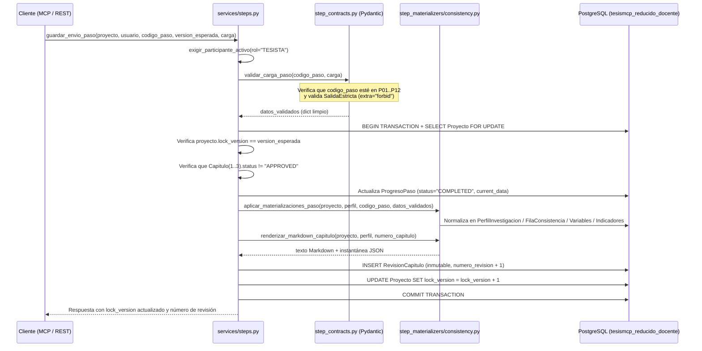

# 03. Flujo Metodológico Paso a Paso: Capítulos 1 al 3 (`P01` a `P12`)

Este documento explica qué ocurre exactamente dentro del código cuando un estudiante o agente IA completa cada uno de los **12 pasos metodológicos** definidos en [`backend/thesis/step_catalogue.py`](../backend/thesis/step_catalogue.py), qué valida [`step_contracts.py`](../backend/thesis/services/step_contracts.py) y qué tablas actualiza [`consistency.py`](../backend/thesis/services/step_materializers/consistency.py).

---

## 1. Secuencia Interna de Guardado (`guardar_envio_paso`)

Cada vez que se invoca `guardar_paso` (vía MCP) o `POST /api/projects/{id}/steps/{step_code}` (vía REST), el código en [`backend/thesis/services/steps.py`](../backend/thesis/services/steps.py) ejecuta esta secuencia determinista:

---

## 2. Capítulo 1: Elección del Tema y Alcance (`P01` a `P05`)

Todos los pasos del Capítulo 1 alimentan la tabla `tesis_perfil_investigacion` (`PerfilInvestigacion`) y regeneran la revisión del `Capitulo(number=1)`.

| Paso | Nombre en Catálogo | Esquema Pydantic (`step_contracts.py`) | Reglas de Validación Estricta | Columnas Actualizadas en PostgreSQL |
| :---: | :--- | :--- | :--- | :--- |
| **`P01`** | Mapa de Temas y Problema | `SalidaP01` | Exige entre **5 y 10** `temas_propuestos` (`min_length=5, max_length=10`). Un `@model_validator` verifica que `tema_preseleccionado_id` exista dentro de la lista de IDs propuestos. | `PerfilInvestigacion.topic_options` (JSON) y `PerfilInvestigacion.selected_topic` (título del tema elegido). |
| **`P02`** | Tipo de Investigación | `SalidaP02` | `enfoque` restringido a `CUANTITATIVO \| CUALITATIVO \| MIXTO`; `alcance` a `EXPLORATORIO \| DESCRIPTIVO \| CORRELACIONAL \| EXPLICATIVO`; `diseno_investigacion` ($\ge 3$ caracteres) y `justificacion_eleccion` ($\ge 20$ caracteres). | `PerfilInvestigacion.research_approach`, `research_scope` y `research_design`. |
| **`P03`** | Población, Muestra y ODS | `SalidaP03` | `tamano_muestra` entero $> 0$; `codigo_meta_ods` validado por expresión regular `^ODS-(0[1-9]\|1[0-7]):[0-9A-Za-z.]+$` (ej. `ODS-04:4.4`). | `PerfilInvestigacion.population_description`, `sample_size` y `sdg_target_code`. |
| **`P04`** | Título de Investigación | `SalidaP04` | `titulo_propuesto` (15 a 300 caracteres), `variable_independiente`, `variable_dependiente`, `unidad_analisis`, `contexto_espacial` y `periodo_temporal`. | Actualiza `Proyecto.title` con el título oficial de la tesis. |
| **`P05`** | Alcance de la Investigación | `SalidaP05` | `alcance_definido` y `justificacion_alcance` ($\ge 30$ caracteres), más listas no vacías (`min_length=1`) de `delimitaciones` y `limitaciones`. | Sincroniza `PerfilInvestigacion.research_scope` y se renderiza en la sección *1.5 Alcance y Delimitaciones* del Capítulo 1. |

---

## 3. Capítulo 2: Realidad Problemática y Justificación (`P06` a `P08`)

Los pasos del Capítulo 2 estructuran el diagnóstico científico del problema y generan las revisiones de `Capitulo(number=2)`.

| Paso | Nombre en Catálogo | Esquema Pydantic (`step_contracts.py`) | Reglas de Validación Estricta | Columnas Actualizadas en PostgreSQL |
| :---: | :--- | :--- | :--- | :--- |
| **`P06`** | Planteamiento del Problema | `SalidaP06` | Exige los **6 bloques metodológicos obligatorios (`CA-S-P-CO-CC-PC`)**, cada uno con mínimo 20 caracteres: `contexto_antecedentes`, `sintomas`, `problematica_central`, `causas_origen`, `consecuencias_pronostico` y `propuesta_control_pronostico`. | Compila los 6 apartados en formato Markdown estructurado dentro de `PerfilInvestigacion.problem_statement_summary`. |
| **`P07`** | Formulación del Problema | `SalidaP07` | `pregunta_general` ($\ge 20$ caracteres) y al menos 2 `preguntas_especificas` (`min_length=2`). | Guarda `PerfilInvestigacion.general_question` para conectarlo en el Capítulo 3 con la Matriz de Consistencia. |
| **`P08`** | Justificación de la Investigación | `SalidaP08` | Exige las 4 dimensiones clásicas de justificación ($\ge 20$ caracteres cada una): `justificacion_teorica`, `justificacion_practica`, `justificacion_metodologica` y `justificacion_social`. | Compila las 4 justificaciones en `PerfilInvestigacion.justification_summary`. |

---

## 4. Capítulo 3: Objetivos, Preguntas, Hipótesis y Operacionalización (`P09` a `P12`)

Aquí ocurre la **normalización relacional más profunda** del proyecto (función [`_materializar_capitulo_3()`](../backend/thesis/services/step_materializers/consistency.py)):

### Paso `P09`: Objetivos e Inicio de la Matriz de Consistencia (`SalidaP09`)
* **Entrada validada:** `objetivo_general` ($\ge 20$ caracteres), `objetivos_especificos` ($\ge 2$) y `resumen_matriz_consistencia`.
* **Materialización en BD (`tesis_fila_consistencia`):**
  1. Crea o actualiza la fila maestra `FilaConsistencia(row_type="GENERAL", row_index=0)` uniendo la `pregunta_general` (de `P07`) con el `objetivo_general` (de `P09`).
  2. Recorre en paralelo las `preguntas_especificas` (de `P07`) y los `objetivos_especificos` (de `P09`) creando las filas `FilaConsistencia(row_type="SPECIFIC", row_index=1..N)` y eliminando filas huérfanas si el número de objetivos disminuyó.

### Paso `P10`: Preguntas Específicas e Hipótesis (`SalidaP10`)
* **Entrada validada:** `preguntas_especificas` ($\ge 2$), `hipotesis_general` ($\ge 15$ caracteres), `hipotesis_nula` ($\ge 15$ caracteres) e `hipotesis_especificas` ($\ge 2$).
* **Materialización en BD (`tesis_fila_consistencia`):**
  1. Completa la fila `GENERAL` (`row_index=0`) inyectando `hypothesis = hipotesis_general` y `null_hypothesis = hipotesis_nula`.
  2. Completa cada fila `SPECIFIC` (`row_index=1..N`) emparejando cada pregunta específica y objetivo específico con su `hipotesis_especifica` correspondiente.

### Paso `P11`: Definición Conceptual y Operacional de Variables (`SalidaP11`)
* **Entrada validada:** Objeto `variable_independiente` y objeto `variable_dependiente` (`ItemVariableP11`: `nombre`, `definicion_conceptual` $\ge 15$ caracteres, `definicion_operacional` $\ge 15$ caracteres).
* **Materialización en BD (`tesis_variable_investigacion` y `tesis_variable_fila_consistencia`):**
  1. Hace `update_or_create` de la variable con código `"VI"` (`role="INDEPENDENT"`) y de la variable con código `"VD"` (`role="DEPENDENT"`).
  2. Vincula automáticamente ambas variables (`VI` y `VD`) con todas las filas de la Matriz de Consistencia del proyecto en la tabla intermedia `VariableFilaConsistencia`.

### Paso `P12`: Matriz de Operacionalización (`SalidaP12`)
* **Entrada validada:** Lista `variables` ($\ge 2$), donde cada variable contiene al menos 1 dimensión (`ItemDimensionP12`), y cada dimensión contiene al menos 1 indicador (`ItemIndicadorP12`: `nombre`, `formula`, `unidad_medida`, `escala_medicion`, `instrumento`).
* **Materialización en BD (`tesis_dimension_variable` y `tesis_indicador`):**
  1. Empareja cada variable enviada con su registro en `VariableInvestigacion` (por nombre o por orden `VI`/`VD`).
  2. Limpia las dimensiones previas de esa variable (`variable.dimensions.all().delete()`) para evitar duplicados y reconstruye limpiamente el árbol jerárquico:
     * Crea cada `DimensionVariable` con su `display_order` (`1, 2, ...`).
     * Crea dentro de cada dimensión sus registros `Indicador` con su fórmula matemática, unidad de medida, escala de medición (`Nominal`, `Ordinal`, `Intervalo`, `Razón`) e instrumento de recolección.
