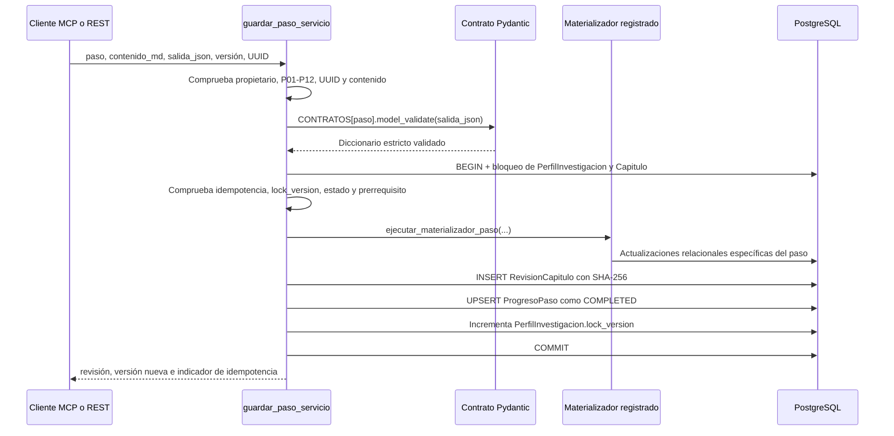

# 03. Flujo Metodológico Paso a Paso: Capítulos 1 al 3 (`P01` a `P12`)

Este documento describe el comportamiento literal de [`step_contracts.py`](../backend/thesis/services/step_contracts.py), [`steps.py`](../backend/thesis/services/steps.py) y los materializadores registrados en [`step_materializers/`](../backend/thesis/services/step_materializers/).

## 1. Secuencia interna de `guardar_paso_servicio`

La herramienta MCP `guardar_paso` y el endpoint REST `PUT /api/v1/projects/{project_id}/steps/{step_code}` delegan en la misma función.

El servicio exige orden secuencial: salvo `P01`, cada paso requiere que el anterior esté `COMPLETED`. El contenido Markdown lo entrega el cliente y se guarda tal cual, con límite de 200 000 caracteres y resumen SHA-256; el backend no inventa ni renderiza contenido académico adicional.

## 2. Contratos reales de los pasos

Todos heredan de `SalidaEstricta`, que usa `ConfigDict(extra="forbid", str_strip_whitespace=True)`.

| Paso | Cap. | Contrato y validaciones principales | Materialización adicional |
| :---: | :---: | :--- | :--- |
| `P01` | 1 | Entre 5 y 10 temas con identificadores únicos; la preselección, si existe, debe pertenecer a la lista. | Se conserva la salida completa en `tesis_progreso_paso.salida_json`. |
| `P02` | 1 | Matriz de exactamente 3 temas; cada puntaje total debe ser la suma de cuatro criterios y el ganador debe existir y alcanzar el máximo. | Salida JSON y nueva revisión del capítulo 1. |
| `P03` | 1 | ODS entre 1 y 17, meta específica, argumento de alineación y línea UTP. | Actualiza `PerfilInvestigacion.codigo_ods` con formato `ODS-NN:meta`. |
| `P04` | 1 | Título de hasta 20 palabras; debe contener variables, unidad de análisis, lugar y periodo declarados. | Actualiza el título del proyecto, unidad de análisis, lugar y periodo. |
| `P05` | 1 | Markdown de al menos 500 caracteres, 3 párrafos y entre 250 y 1200 palabras; los conteos declarados deben coincidir. | Salida JSON y nueva revisión del capítulo 1. |
| `P06` | 2 | Problema central, 2 a 5 causas, 2 a 5 efectos, pregunta general con signos `¿?` y 2 a 4 preguntas específicas. | Actualiza el planteamiento y crea las preguntas general (`orden=0`) y específicas en `tesis_fila_consistencia`. |
| `P07` | 2 | Exactamente cuatro justificaciones: `TEORICA`, `PRACTICA`, `METODOLOGICA` y `SOCIAL`, sin duplicados. | Salida JSON y nueva revisión del capítulo 2. |
| `P08` | 2 | Brecha detectada, aporte propuesto y estado fijo `PENDING_EVIDENCE`. | Salida JSON y nueva revisión del capítulo 2. |
| `P09` | 3 | Objetivo general y 2 a 4 objetivos específicos iniciados con verbos de Bloom permitidos. | Completa los objetivos de las filas de consistencia y exige igual cantidad que las preguntas de `P06`. |
| `P10` | 3 | Pregunta general y 2 a 4 preguntas específicas, todas con signos `¿?`. | Sincroniza las preguntas de la matriz y exige igual cantidad que los objetivos de `P09`. |
| `P11` | 3 | Tipo de investigación, hipótesis general y específicas, variable independiente y dependiente. | Completa hipótesis, crea dos variables (`INDEPENDENT` y `DEPENDENT`) y las vincula con todas las filas de consistencia. |
| `P12` | 3 | Matriz con definiciones, dimensiones, indicadores y escala `NOMINAL`, `ORDINAL`, `INTERVALO` o `RAZON`. | Exige coincidencia exacta con las variables de `P11` y materializa dimensiones e indicadores. |

## 3. Persistencia y revisión docente

- Cada guardado crea una `RevisionCapitulo` nueva; la clave UUID brinda idempotencia por capítulo.
- PostgreSQL impide `UPDATE` y `DELETE` sobre revisiones y eventos mediante la función `tesis_rechazar_cambio_historial` y dos triggers.
- Un capítulo solo puede enviarse cuando todos sus pasos están completados.
- El asesor no puede aprobar mientras existan observaciones abiertas.
- Un capítulo aprobado vuelve a `DRAFT` cuando el asesor ejecuta `REOPEN` con un motivo.
