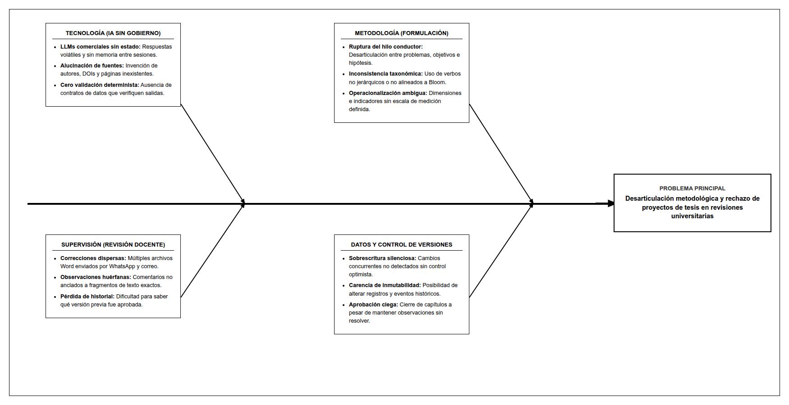
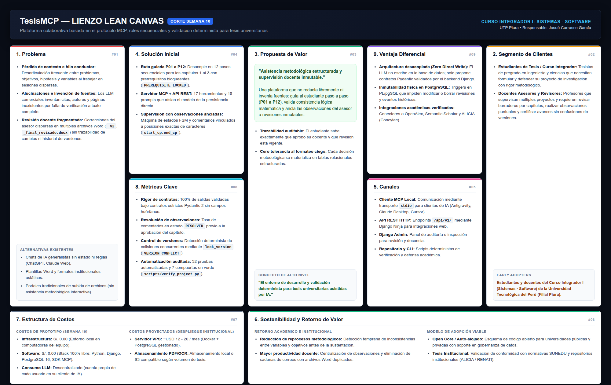
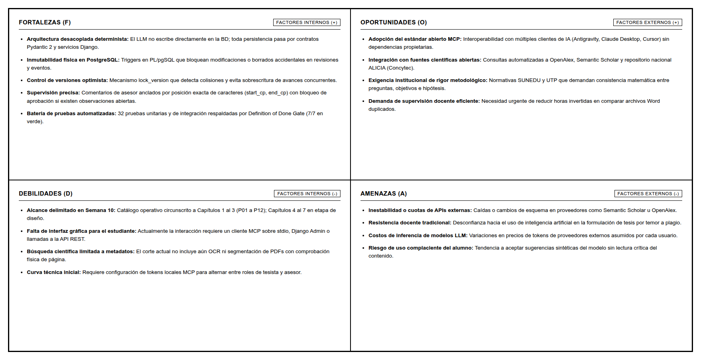
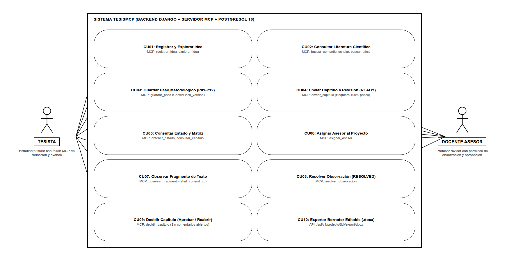
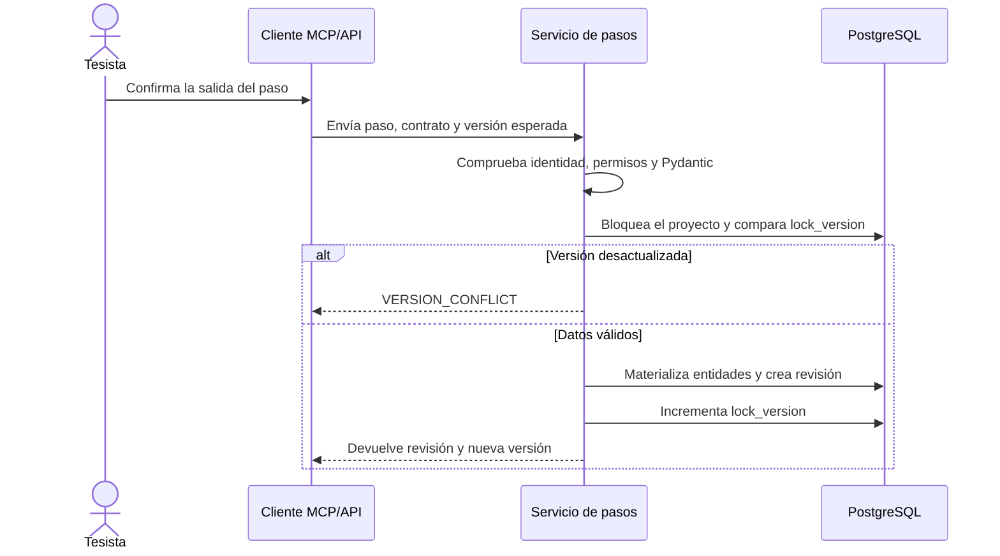
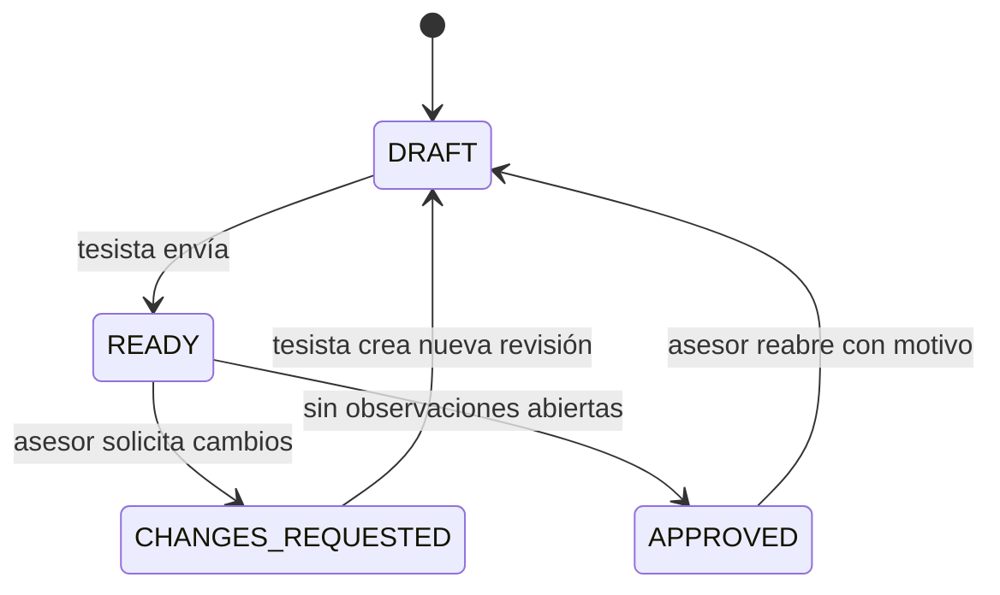
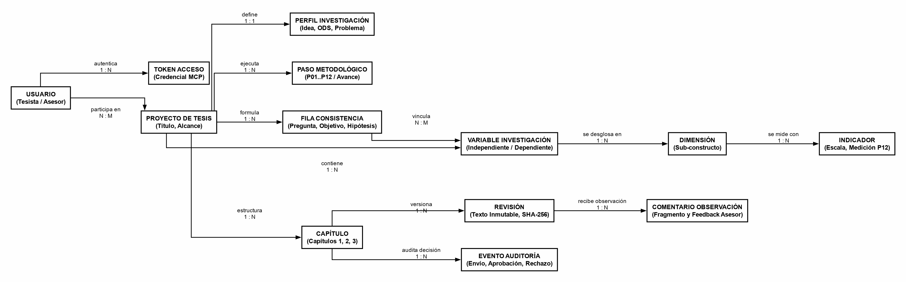
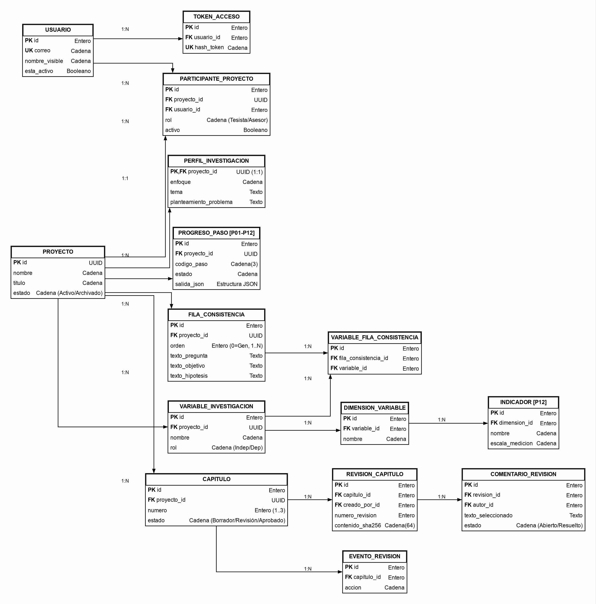
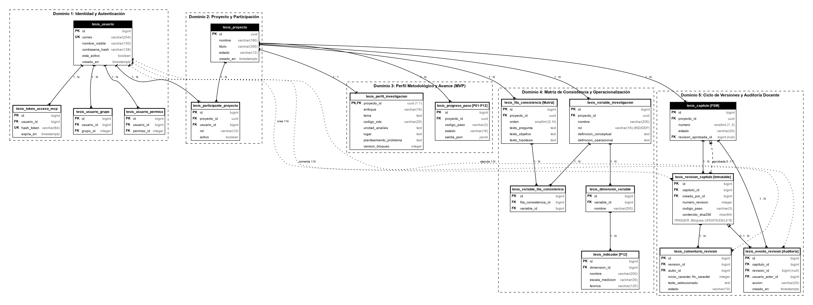
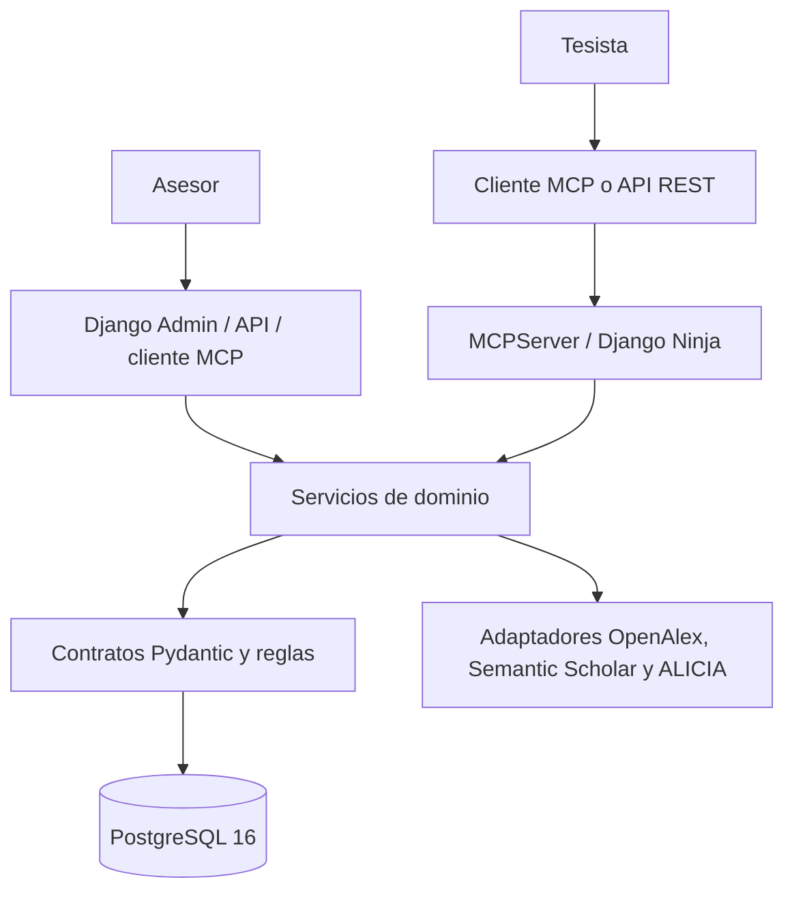

# INFORME BASE DEL PROYECTO — CORTE DE SEMANA 10
## ESCUELA PROFESIONAL DE INGENIERÍA DE SISTEMAS E INFORMÁTICA

---

> **Estado del documento:** base editable para la entrega académica de Semana 10.  
> **Cómo está escrito:** se explica primero lo que ya funciona y después lo que se piensa añadir. Se evita presentar una idea futura como si ya estuviera terminada.  
> **Fuente técnica principal:** código, migraciones y pruebas automatizadas del repositorio. El [informe académico general](../../docs/06_informe_final_curso/informe_academico_curso_integrador.md) se empleó como referencia de estructura y orientación académica.

### TÍTULO DEL PROYECTO

**“Desarrollo de una plataforma colaborativa basada en el protocolo MCP, roles secuenciales y validación determinista para la asistencia metodológica y supervisión de tesis universitarias”**

- **Autor / líder del proyecto:** Josué Carrasco García
- **Integrantes:** [Completar con los nombres del equipo]
- **Institución:** Universidad Tecnológica del Perú (UTP) — sede Piura
- **Carrera:** Ingeniería de Sistemas e Informática
- **Ciclo:** 7.º ciclo
- **Curso:** Curso Integrador I: Sistemas — Software
- **Docente:** [Completar]
- **Fecha:** octubre de 2026
- **Entrega:** Semana 10

---

## RESUMEN EJECUTIVO

TesisMCP es una herramienta que acompaña al estudiante mientras arma su proyecto de tesis. En vez de pedirle a una inteligencia artificial que escriba todo de golpe, el trabajo se divide en pasos cortos. Cada paso tiene campos obligatorios y reglas que se revisan antes de guardar la información.

Al corte de Semana 10 se dispone de un núcleo funcional para los capítulos 1, 2 y 3, organizado en doce pasos metodológicos (`P01` a `P12`). El estudiante puede crear un proyecto, desarrollar cada paso mediante un cliente compatible con MCP o mediante la API REST, conservar el estado metodológico en PostgreSQL y enviar capítulos a revisión. El asesor puede registrar observaciones ancladas al texto, resolverlas, solicitar cambios, aprobar una revisión concreta o reabrir un capítulo.

La solución actual usa Django, Django Ninja, Pydantic, el SDK oficial de MCP y PostgreSQL 16. Su estructura contiene 15 modelos Django, 17 tablas físicas propias con nombres en español, 2 migraciones, 17 herramientas MCP, 15 prompts MCP y 32 pruebas automatizadas. Estos números describen lo que existe en el corte actual; no representan todavía el alcance final pensado para el proyecto.

En los siguientes incrementos se prevé ampliar el recorrido hasta `P32` y los capítulos 4 al 7, incorporar procesamiento de documentos PDF a texto completo, trazabilidad de citas hasta la página física, una interfaz web propia para el estudiante, exportación institucional y pruebas de usabilidad con participantes reales. Mientras esas capacidades no se incorporen, los resultados provenientes de OpenAlex, Semantic Scholar y ALICIA deben tratarse como metadatos para exploración, no como evidencia textual ya comprobada.

**Palabras clave:** Model Context Protocol, tesis universitaria, PostgreSQL, Django, validación determinista, revisión académica, inteligencia artificial.

---

## QUÉ PUEDE HACER EL SISTEMA HOY

Antes de entrar a los capítulos del informe, conviene dejar claro qué se puede demostrar ahora mismo.

### Para el tesista

El tesista puede crear un proyecto, registrar una idea, revisar el catálogo de pasos y avanzar desde `P01` hasta `P12`. El sistema guarda el tema, el título, el problema, las preguntas, los objetivos, las hipótesis y las variables para que esa información vuelva a aparecer cuando se necesite en los pasos siguientes.

También puede buscar posibles antecedentes en servicios externos. En esta etapa, la búsqueda ayuda a encontrar títulos, autores, años, enlaces y otros metadatos. El resultado sirve como punto de partida, pero el estudiante todavía debe abrir y leer el documento antes de usarlo como evidencia.

Cuando termina los pasos de un capítulo, puede enviarlo a revisión. Si el asesor solicita cambios, el tesista consulta las observaciones, corrige el contenido y guarda una revisión nueva. Las revisiones anteriores no se reemplazan.

### Para el asesor

El asesor puede entrar con una identidad distinta, consultar el proyecto que tiene asignado, leer la revisión vigente y comentar un fragmento exacto. El comentario guarda el texto seleccionado, su posición y la explicación escrita por el asesor.

Después puede solicitar cambios, marcar una observación como resuelta, aprobar el capítulo o reabrir uno que ya había aprobado. Si todavía queda un comentario abierto, el sistema no permite aprobar.

### Lo que se puede demostrar en vivo

En una sola computadora se pueden simular las dos cuentas:

```text
Computadora local
├── cuenta del tesista + token MCP del tesista
├── cuenta del asesor + token MCP del asesor
├── backend Django
└── PostgreSQL
```

La computadora es la misma, pero el backend reconoce usuarios y permisos diferentes. Primero se trabaja con el token del tesista; después se abre otra conexión con el token del asesor. Los datos no desaparecen al cambiar de cuenta porque quedan guardados en PostgreSQL.

### Lo que todavía no se ve como una aplicación terminada

Los comentarios existen y se pueden consultar, pero aún no aparecen como globos al margen o texto resaltado dentro de una web propia. Tampoco existe por ahora un portal público donde el estudiante y el profesor ingresen desde computadoras diferentes.

El backend ofrece una API, un panel administrativo y el servidor MCP. Falta construir la experiencia visual que reúna esas funciones en pantallas sencillas para cada usuario.

---

## ÍNDICE PROPUESTO

1. Descripción de la situación problemática
2. Marco conceptual y antecedentes
3. Objetivos y justificación
4. Planificación del proyecto
5. Técnicas e instrumentos de recolección de datos
6. Metodología y desarrollo de la solución
   - Diagnóstico
   - Riesgos de TI
   - Requerimientos
   - Flujo operativo
   - Estados, datos y contratos
   - Alternativas de solución
   - Prototipo funcional y próximos incrementos
7. Conclusiones preliminares
8. Referencias bibliográficas

---

## CAPÍTULO I: DESCRIPCIÓN DE LA SITUACIÓN PROBLEMÁTICA

### 1.1 Contexto

El proyecto se desarrolla en el contexto de la Universidad Tecnológica del Perú, sede Piura, dentro de la carrera de Ingeniería de Sistemas e Informática. La propuesta se enfoca en el trabajo académico que realizan estudiantes y asesores durante la formulación de una tesis.

La elaboración de los primeros capítulos requiere mantener coherencia entre el tema, el título, el problema, las preguntas, los objetivos, las hipótesis y las variables. Una modificación en cualquiera de estos elementos puede obligar a revisar los demás. Cuando el proceso se distribuye entre conversaciones aisladas con asistentes de inteligencia artificial, documentos independientes y mensajes sin historial común, se incrementa el riesgo de perder decisiones previas o trabajar sobre una revisión desactualizada.

TesisMCP plantea un circuito en el que la inteligencia artificial propone contenido, pero el backend aplica contratos, permisos y reglas deterministas antes de persistirlo. El asesor conserva la responsabilidad de la revisión académica y de la aprobación de cada capítulo.

### 1.2 Descripción del problema

El problema se organiza en tres dimensiones:

1. **Discontinuidad metodológica.** Los datos aprobados en una sesión pueden no estar disponibles o pueden reformularse de manera contradictoria en una conversación posterior.
2. **Riesgo de información no comprobada.** Una referencia localizada por un buscador o propuesta por un modelo no demuestra por sí sola que el documento respalde una afirmación concreta.
3. **Dispersión de revisiones.** Los comentarios del asesor pueden quedar repartidos entre archivos y mensajes, dificultando identificar la versión vigente y las observaciones aún abiertas.

Estas dificultades constituyen la motivación técnica del proyecto. Su frecuencia e impacto en usuarios reales deberán medirse posteriormente mediante instrumentos de recolección de datos; el presente informe no atribuye porcentajes ni mejoras que todavía no han sido observados.

El análisis de causas y efectos que dan origen a esta problemática se sintetiza en la Figura 1.1:



*Figura 1.1: Diagrama de Causa-Efecto (Ishikawa) de la situación problemática en la formulación de tesis.*  
*[Descargar archivo editable (.drawio)](./diagramas/01_ishikawa_situacion_problematica.drawio)*

### 1.2.1 Cómo se suele trabajar sin el sistema

Un recorrido común puede verse así:

1. El estudiante conversa con una herramienta de inteligencia artificial para buscar un tema.
2. Copia una propuesta en Word.
3. El docente comenta otra copia del archivo.
4. El estudiante vuelve al chat, pero el asistente ya no conoce todos los acuerdos anteriores.
5. Se cambia una variable o un objetivo y algunas partes del documento quedan con la versión anterior.
6. Aparecen varios archivos con nombres parecidos y no siempre queda claro cuál fue revisado.

Este ejemplo no se presenta como resultado de una encuesta. Es la situación de trabajo que motiva el diseño del prototipo y que más adelante debe compararse con información recogida de estudiantes y docentes.

### 1.2.2 Qué cambia con TesisMCP

Con TesisMCP, el contenido no depende únicamente del historial visible de un chat. Los datos centrales se guardan en tablas relacionadas. Por ejemplo, las preguntas, objetivos e hipótesis terminan en filas de una matriz de consistencia; las variables terminan relacionadas con dimensiones e indicadores.

El asistente sigue siendo útil para proponer redacciones, pero no decide por sí solo qué se guarda. El estudiante confirma la propuesta y el backend revisa el contrato. Si algo no cumple la forma esperada, devuelve un error claro y mantiene intactos los datos anteriores.

### 1.2.3 Problema que este avance sí atiende

El corte de Semana 10 se concentra en el inicio de la tesis. Ayuda a pasar de una idea amplia a una estructura con título, problema, objetivos, hipótesis y variables. También deja listo un primer circuito de revisión docente.

Todavía no intenta cubrir la aplicación de encuestas, el análisis estadístico de resultados, la sustentación o el trámite administrativo de titulación. Esas actividades tienen reglas y responsables distintos.

### 1.3 Formulación del problema

#### Problema general

¿De qué manera una plataforma colaborativa basada en el protocolo MCP y en validaciones deterministas puede apoyar la elaboración metodológica y la supervisión de tesis universitarias, manteniendo coherencia, trazabilidad y control de versiones?

#### Problemas específicos

- **PE1:** ¿Cómo conservar de forma estructurada el tema, el título, el problema, los objetivos, las hipótesis y las variables para reutilizarlos sin contradicciones?
- **PE2:** ¿Cómo impedir que un cliente de inteligencia artificial omita campos obligatorios, altere el orden de los pasos o sobrescriba cambios concurrentes?
- **PE3:** ¿Cómo registrar revisiones, observaciones y aprobaciones del asesor sin perder el historial de cada capítulo?
- **PE4:** ¿Cómo evolucionar desde la exploración bibliográfica por metadatos hacia evidencia verificable en documentos a texto completo y páginas físicas?

### 1.4 Alcance del corte de Semana 10

El alcance operativo actual comprende:

- capítulos 1, 2 y 3;
- pasos metodológicos `P01` a `P12`;
- creación y consulta de proyectos;
- persistencia de perfiles, avances, matriz de consistencia, variables, dimensiones e indicadores;
- validación estricta de las salidas del asistente;
- control de acceso para tesista y asesor;
- control de concurrencia optimista mediante `lock_version`;
- versionado de capítulos y registro inmutable de eventos de revisión;
- observaciones ancladas, resolución, solicitud de cambios, aprobación y reapertura;
- exploración de metadatos en OpenAlex, Semantic Scholar y ALICIA;
- almacenamiento del contenido en Markdown y descarga de un borrador editable `.docx` mediante la API.

### 1.5 Delimitaciones actuales y éticas

- La inteligencia artificial no guarda datos directamente; las operaciones pasan por los servicios de dominio.
- Los contratos Pydantic comprueban estructura, tipos y ciertas reglas metodológicas, pero no demuestran por sí mismos la veracidad científica del contenido.
- Las búsquedas externas del corte actual recuperan metadatos. No deben presentarse como lectura integral ni como validación del contenido de un PDF.
- No se generan respuestas ficticias de encuestas, entrevistas ni estadísticas de trabajo de campo.
- La aprobación del asesor se aplica a una revisión identificable del capítulo, no a una conversación informal con el asistente.

---

## CAPÍTULO II: MARCO CONCEPTUAL Y ANTECEDENTES

### 2.1 Conceptos centrales

#### 2.1.1 Model Context Protocol

MCP define un mecanismo estandarizado para que un cliente de inteligencia artificial invoque herramientas y solicite recursos o prompts provistos por un servidor. En TesisMCP, el cliente propone y consulta; el servidor MCP adapta la solicitud y la remite al núcleo de servicios, donde se verifican identidad, permisos, versión esperada y contrato de datos antes de persistir cualquier cambio (Anthropic, 2024).

#### 2.1.2 Arquitectura por capas

El backend aplica programación orientada a objetos y separa presentación, adaptadores de comunicación, servicios de dominio, integraciones externas y persistencia. Esta organización toma como referencia principios generales de análisis y diseño orientado a objetos (Booch et al., 2007) y permite que la API REST, el panel administrativo y el servidor MCP reutilicen las mismas reglas de negocio sin duplicarlas.

#### 2.1.3 Validación determinista

Cada paso dispone de un contrato Pydantic con campos y restricciones explícitas. La configuración `extra="forbid"` rechaza atributos no definidos. Además, los servicios comprueban relaciones entre pasos, por ejemplo, la correspondencia entre preguntas, objetivos e hipótesis o la presencia de las variables confirmadas en el título y en la matriz.

#### 2.1.4 Persistencia relacional e inmutabilidad

PostgreSQL conserva entidades metodológicas relacionadas y aplica restricciones físicas. Las revisiones de capítulos y los eventos de revisión se protegen mediante disparadores que bloquean su actualización o eliminación, por lo que las correcciones se registran como nuevas revisiones en lugar de sobrescribir el historial.

### 2.1.5 Explicación sencilla de las piezas

Una forma práctica de entender el sistema es separar quién propone, quién revisa y quién guarda:

| Pieza | Qué hace | Qué no debe hacer |
| :--- | :--- | :--- |
| Cliente de IA | Conversa con el usuario y propone una respuesta para el paso actual. | No escribe directamente en PostgreSQL. |
| Servidor MCP | Publica herramientas y convierte la solicitud del cliente en una operación conocida. | No reemplaza las reglas de negocio. |
| Servicios Django | Revisa permisos, contratos, orden de pasos y estado del capítulo. | No debe confiar ciegamente en el texto enviado por el modelo. |
| PostgreSQL | Guarda proyectos, versiones, matrices, variables y comentarios. | No genera contenido académico. |
| Tesista | Decide qué propuesta acepta y envía su capítulo. | No puede aprobar su propio capítulo. |
| Asesor | Observa, solicita cambios, resuelve comentarios y aprueba. | No puede editar silenciosamente el texto del tesista. |

### 2.1.6 MCP no es el modelo de inteligencia artificial

Es fácil confundir ambos conceptos. El modelo es el que redacta o conversa. MCP es el medio por el cual ese modelo puede llamar funciones concretas. Por ejemplo, el modelo puede sugerir un título y luego invocar `guardar_paso`; sin embargo, el backend puede rechazarlo si supera veinte palabras o no incluye los componentes confirmados.

El proyecto sigue un enfoque donde cada usuario puede emplear su propio cliente compatible. El backend no contiene una cuenta central pagada de inteligencia artificial y no hace llamadas automáticas a un proveedor para redactar la tesis.

### 2.1.7 Qué significa “validar” en este proyecto

Validar no significa afirmar que una idea científica es correcta. En el corte actual significa comprobar cosas que sí pueden expresarse como reglas:

- que estén presentes los campos obligatorios;
- que una lista tenga la cantidad permitida de elementos;
- que el título no pase el límite configurado;
- que una pregunta tenga signos de interrogación;
- que los objetivos comiencen con verbos admitidos;
- que preguntas, objetivos e hipótesis tengan la misma cantidad;
- que un usuario tenga permiso para realizar la acción;
- que nadie haya guardado otra modificación con una versión más reciente.

La calidad teórica, la pertinencia de una fuente y la decisión de aprobar siguen necesitando revisión humana.

### 2.2 Antecedentes de referencia

El informe general del proyecto identifica tres líneas de antecedentes que deben conservarse en la redacción definitiva:

1. **Asistencia a la investigación con inteligencia artificial:** trabajos sobre síntesis científica, generación de ideas y redacción extensa guiada (Skarlinski et al., 2024; Su et al., 2025; Wan et al., 2025).
2. **Sistemas universitarios de gestión de tesis:** experiencias nacionales relacionadas con seguimiento, gestión documental y control de proyectos académicos (Chauca Florian, 2024; Córdova Carrascal & Paulini Pereyra, 2020; Cáceres Saldaña & Osores Salgado, 2025).
3. **Contexto local:** propuestas desarrolladas en instituciones de Piura vinculadas con interoperabilidad o repositorios académicos (Rosales Rosas, 2020).

Para la versión final de este capítulo, cada afirmación metodológica o resultado atribuido a un antecedente deberá trasladarse desde la matriz de antecedentes verificada, indicando el documento y la página física exacta. No se deben copiar cifras ni conclusiones basándose únicamente en el título, resumen o metadatos.

### 2.3 Brecha abordada

La brecha funcional planteada es la ausencia, dentro de un mismo flujo, de los siguientes elementos:

- guía metodológica por pasos;
- persistencia relacional de decisiones académicas;
- contratos deterministas para las salidas del asistente;
- control de concurrencia;
- historial de revisiones y observaciones del asesor;
- conexión desacoplada con clientes de inteligencia artificial mediante MCP.

El presente corte demuestra la integración de esos componentes para los capítulos 1 al 3. La comprobación de fuentes a texto completo y la experiencia web integral forman parte de la evolución prevista.

---

## CAPÍTULO III: OBJETIVOS Y JUSTIFICACIÓN

### 3.1 Objetivo general

Desarrollar progresivamente una plataforma colaborativa basada en MCP que guíe la formulación metodológica de una tesis, conserve la coherencia entre sus componentes y permita al asesor revisar versiones, registrar observaciones y aprobar avances con trazabilidad.

### 3.2 Objetivos específicos

- **OE1:** Implementar un flujo guiado para los capítulos 1 al 3 mediante los pasos `P01` a `P12` y contratos de datos estrictos.
- **OE2:** Diseñar un modelo relacional en PostgreSQL que conserve proyectos, participantes, progreso, matriz de consistencia, variables y revisiones.
- **OE3:** Exponer las capacidades del dominio mediante una API REST y un servidor MCP compatibles con diferentes clientes.
- **OE4:** Implementar un circuito de revisión docente con observaciones ancladas, estados controlados e historial inmutable.
- **OE5:** Extender en los siguientes incrementos el recorrido hasta los capítulos 4 al 7, incorporando evidencia documental a texto completo, experiencia web, exportación institucional y evaluación con usuarios.

### 3.3 Justificación

- **Social:** La propuesta busca brindar al estudiante una secuencia clara de trabajo y al asesor una vista ordenada de las revisiones. Su impacto real deberá evaluarse con usuarios antes de formular conclusiones sobre mejora académica.
- **Práctica:** Centralizar decisiones, versiones y observaciones puede reducir la pérdida de contexto; el posible ahorro de tiempo se mantiene como una hipótesis de evaluación, no como un resultado demostrado.
- **Metodológica:** El sistema representa preguntas, objetivos, hipótesis, variables, dimensiones e indicadores como elementos relacionados, facilitando la comprobación estructural de su consistencia.
- **Técnica:** La arquitectura combina MCP, API REST, contratos Pydantic, servicios transaccionales y PostgreSQL, conservando desacoplado el cliente de inteligencia artificial.

---

## CAPÍTULO IV: PLANIFICACIÓN DEL PROYECTO

### 4.1 Lienzo Lean Canvas

El siguiente lienzo resume el modelo de valor del proyecto para el corte de Semana 10:



*Figura 4.1: Lienzo Lean Canvas del proyecto TesisMCP (Corte Semana 10).*

El siguiente cuadro detalla cada bloque del lienzo sin asumir que sus beneficios ya fueron medidos:

| Bloque | Aplicación en TesisMCP |
| :--- | :--- |
| **Problema** | Pérdida de contexto entre sesiones, referencias que todavía no han sido comprobadas y revisiones repartidas en varios archivos. |
| **Usuarios principales** | Estudiantes que preparan una tesis y docentes que revisan sus avances. |
| **Propuesta de valor** | Una ruta paso a paso que guarda las decisiones metodológicas y mantiene las observaciones vinculadas con una revisión concreta. |
| **Solución inicial** | Servidor MCP, API, PostgreSQL, doce pasos para los primeros tres capítulos y flujo de revisión docente. |
| **Canales** | Cliente MCP local, API REST, panel Django Admin, repositorio del curso y demostración técnica. |
| **Costos** | Desarrollo en equipos propios y herramientas de software libre. Los posibles pagos de un cliente de IA corresponden a la cuenta de cada usuario. |
| **Métricas por evaluar** | Pasos completados sin errores de contrato, observaciones abiertas, revisiones por capítulo y tiempo de respuesta del asesor. |
| **Diferencia técnica** | El asistente no guarda libremente: usa herramientas y contratos; el backend controla permisos, versión y consistencia. |
| **Riesgo principal** | Confundir una respuesta bien escrita o un metadato bibliográfico con evidencia académica ya verificada. |

La propuesta de valor no es “hacer la tesis automáticamente”. La utilidad esperada es ordenar el proceso y dejar rastros claros de lo que se cambió. Que esto ahorre tiempo o mejore resultados tendrá que comprobarse con usuarios.

### 4.2 Acta de constitución del proyecto

- **Nombre:** TesisMCP.
- **Propósito:** construir una herramienta que ayude a organizar la formulación de la tesis y la revisión del asesor.
- **Alcance de Semana 10:** capítulos 1, 2 y 3; pasos `P01` a `P12`; PostgreSQL; MCP; API; control de revisiones.
- **Responsable del proyecto:** Josué Carrasco García.
- **Equipo:** [Completar con integrantes y responsabilidades].
- **Usuarios considerados:** tesista y asesor.
- **Condición técnica:** funcionamiento local con cuentas y tokens separados.
- **Condición académica:** el docente sigue teniendo la decisión final sobre la calidad del trabajo.

#### 4.2.1 Objetivos medibles del avance

1. Mantener exactamente doce pasos activos distribuidos en los capítulos 1, 2 y 3.
2. Rechazar cualquier salida que no cumpla su contrato Pydantic.
3. Evitar que dos guardados con versiones diferentes se sobrescriban.
4. Conservar revisiones y eventos anteriores sin permitir su modificación directa.
5. Impedir la aprobación de un capítulo con observaciones abiertas.
6. Mantener sincronizados el código, las migraciones, el esquema físico y la documentación.

#### 4.2.2 Interesados

- estudiantes que desarrollan proyectos de tesis;
- docentes asesores y revisores;
- docente del Curso Integrador;
- coordinación académica de la carrera;
- equipo de desarrollo y aseguramiento de calidad.

#### 4.2.3 Riesgos principales

| Código | Riesgo | Efecto posible | Tratamiento planteado |
| :---: | :--- | :--- | :--- |
| R01 | Referencias o afirmaciones inventadas por el modelo | Contenido académico no verificable | Mantener advertencias en búsquedas por metadatos e incorporar evidencia a página física en un incremento posterior. |
| R02 | Sobrescritura de avances concurrentes | Pérdida silenciosa de cambios | Comparar `expected_version` con `lock_version` dentro de una transacción. |
| R03 | Aprobación con observaciones abiertas | Cierre inconsistente de un capítulo | Bloquear la aprobación hasta resolver las observaciones vigentes. |
| R04 | Caída de un buscador externo | La exploración bibliográfica no responde | Mantener las integraciones separadas del núcleo y devolver el error sin inventar resultados. |
| R05 | Confusión entre metadatos y evidencia textual | Uso incorrecto de una referencia | Mostrar el nivel de verificación y añadir después la extracción de PDF con páginas. |
| R06 | Interfaz difícil de entender | El usuario no sabe qué acción sigue | Diseñar pantallas sencillas y probarlas con usuarios antes de considerarlas definitivas. |
| R07 | Exposición accidental de tokens | Acceso no autorizado a un proyecto | Guardar únicamente el hash, limitar permisos y no incluir tokens en documentos o repositorios. |

### 4.3 Cronograma de trabajo

El desarrollo del proyecto se organiza en 16 semanas académicas. La siguiente tabla detalla la planificación temporal, distinguiendo con rigor los componentes completados para el corte actual de aquellos previstos para los siguientes incrementos:

| Fase / Actividad | Semanas | Entregables clave | Estado en Semana 10 |
| :--- | :---: | :--- | :---: |
| **Fase 1: Diagnóstico y Alcance** | Semanas 1 – 3 | Matriz CA-S-P-CO-CC-PC, problema, objetivos preliminares y Lean Canvas. | **Completado** |
| **Fase 2: Arquitectura y Datos** | Semanas 4 – 6 | Modelo relacional, 17 tablas en PostgreSQL 16 y disparadores de inmutabilidad. | **Completado** |
| **Fase 3: Servidor MCP y Pasos** | Semanas 7 – 9 | 17 herramientas MCP, 15 prompts y contratos Pydantic para pasos `P01` a `P12`. | **Completado** |
| **Fase 4: Módulo de Supervisión** | Semanas 9 – 10 | Máquina de estados FSM, comentarios anclados (`start_cp:end_cp`) y 32 pruebas. | **Completado** |
| **HITO ACTUAL: Corte Semana 10** | **Semana 10** | **Capítulos 1 al 3 operativos, API REST, Django Admin y Definition of Done.** | **ENTREGADO** |
| **Fase 5: Extensión Metodológica** | Semanas 11 – 12 | Implementación de catálogo `P13` a `P32` para los Capítulos 4 al 7. | *Previsto* |
| **Fase 6: Evidencia Documental** | Semanas 13 – 14 | Ingesta controlada de PDFs, comprobación física de páginas y OCR. | *Previsto* |
| **Fase 7: Interfaz y Cierre** | Semanas 14 – 16 | Portal web para el tesista, panel docente, pruebas con usuarios y sustentación. | *Previsto* |

#### 4.3.1 Criterio para avanzar de una etapa a otra

Cada incremento debe pasar primero sus pruebas, revisión de migraciones, comprobación de enlaces y auditoría de documentación. Agregar más funciones sin esas verificaciones haría más difícil distinguir un avance real de una demostración que solo funciona en un caso preparado.

### 4.4 Presupuesto base

El software empleado en el corte actual es de código abierto y funciona en un equipo local. Por eso no se registra un pago obligatorio por licencias del backend o de PostgreSQL.

| Rubro | Situación actual | Observación |
| :--- | :--- | :--- |
| Backend y servidor MCP | Sin costo de licencia | Python, Django y SDK MCP. |
| Base de datos | Sin costo de licencia | PostgreSQL ejecutado localmente. |
| Cliente de inteligencia artificial | Depende de cada usuario | Puede utilizar una cuenta gratuita o pagada; no se carga al servidor. |
| Alojamiento | Sin gasto en el corte local | Un despliegue posterior podría generar costo. |
| Equipo e internet | Recursos ya disponibles | No se compraron para este avance. |
| Impresión y presentación | Por confirmar | Depende de lo que solicite el curso. |

No se asigna un costo inventado a horas de trabajo o infraestructura futura. Si la rúbrica exige un presupuesto monetario detallado, deberá completarse con cotizaciones y decisiones reales del equipo.

---

## CAPÍTULO V: TÉCNICAS E INSTRUMENTOS DE RECOLECCIÓN DE DATOS

### 5.1 Técnicas propuestas

Se prevé emplear las siguientes técnicas cuando el proyecto ingrese a la etapa de evaluación con usuarios:

1. **Encuesta a estudiantes:** para conocer el proceso de formulación, las herramientas utilizadas y la forma en que reciben correcciones.
2. **Entrevista semiestructurada a asesores:** para identificar necesidades de revisión, seguimiento y trazabilidad.
3. **Prueba de tareas:** para observar si los participantes pueden crear un proyecto, completar un paso, enviar un capítulo y atender una observación.

### 5.2 Instrumentos previstos

- cuestionario para estudiantes;
- guía de entrevista para docentes asesores;
- lista de tareas de usabilidad;
- ficha de observación y registro de incidencias.

Estos instrumentos todavía deben ser revisados y aplicados. Por tanto, este documento no presenta tamaños de muestra, porcentajes de aceptación, tiempos de mejora ni resultados estadísticos.

---

## CAPÍTULO VI: METODOLOGÍA Y DESARROLLO DE LA SOLUCIÓN

### 6.1 Fase 01: Diagnóstico

#### 6.1.1 Análisis FODA

| Factores internos | Factores externos |
| :--- | :--- |
| **Fortalezas:** pasos definidos, PostgreSQL, contratos estrictos, historial de revisiones y separación de roles. | **Oportunidades:** uso creciente de asistentes de IA, disponibilidad de catálogos científicos abiertos y necesidad de ordenar la revisión de tesis. |
| **Debilidades:** ejecución principalmente local, falta de una web propia y búsqueda bibliográfica limitada a metadatos. | **Amenazas:** cambios en servicios externos, respuestas incorrectas del modelo, exposición de credenciales o resistencia de usuarios acostumbrados a Word y correo. |

La matriz estratégica resultante se ilustra en la Figura 6.1:



*Figura 6.1: Matriz FODA del Proyecto TesisMCP — Fase 01: Diagnóstico Estratégico.*  
*[Descargar archivo editable (.drawio)](./diagramas/02_foda_diagnostico_estrategico.drawio)*

#### 6.1.2 Causas que se busca atender

El problema puede separarse en cuatro grupos:

- **Método:** se intenta escribir demasiado antes de confirmar tema, problema y objetivos.
- **Herramientas:** cada conversación o archivo conserva una parte distinta del contexto.
- **Comunicación:** las observaciones no siempre están unidas a la versión que las originó.
- **Fuentes:** un enlace o una referencia con apariencia correcta puede usarse sin comprobar el texto completo.

Estas causas todavía deben contrastarse con encuestas y entrevistas. En esta etapa sirven para organizar el diseño técnico.

### 6.2 Fase 02: Análisis de riesgos de TI

Los riesgos principales se presentaron en la sección 4.2.3. Desde el punto de vista técnico, el proyecto aplica estas respuestas:

| Riesgo técnico | Control actual | Control previsto |
| :--- | :--- | :--- |
| Salida mal formada del modelo | Contratos Pydantic y `extra="forbid"`. | Ampliar contratos a `P13`–`P32`. |
| Usuario sin permiso | Comprobación de participante y rol. | Revisiones adicionales antes del despliegue público. |
| Cambio concurrente | `lock_version` y transacciones. | Mostrar el conflicto de forma visual en la web. |
| Historial alterado | Revisiones nuevas y disparadores de PostgreSQL. | Políticas de respaldo del servidor. |
| Fuente no comprobada | Advertencia de que la búsqueda devuelve metadatos. | PDF, extracción, página física y revisión humana. |
| Dependencia de internet | Los fallos de integraciones no cambian el núcleo guardado. | Reintentos y estado visible de cada servicio. |

### 6.3 Fase 03: Especificación de requerimientos

#### 6.3.1 Requerimientos funcionales

| Código | Requerimiento | Situación en Semana 10 |
| :---: | :--- | :---: |
| RF01 | Crear un proyecto y reconocer al tesista titular. | Implementado |
| RF02 | Registrar y consultar la idea provisional. | Implementado |
| RF03 | Guiar los pasos `P01`–`P12` en orden. | Implementado |
| RF04 | Guardar matriz de consistencia y operacionalización. | Implementado |
| RF05 | Consultar metadatos científicos externos. | Implementado con delimitación |
| RF06 | Asignar un asesor activo al proyecto. | Implementado |
| RF07 | Enviar un capítulo completo a revisión. | Implementado |
| RF08 | Comentar un fragmento de la revisión vigente. | Implementado en MCP/API, sin vista web propia |
| RF09 | Solicitar cambios, resolver observaciones y aprobar. | Implementado en backend |
| RF10 | Exportar un borrador editable `.docx`. | Implementado mediante API; no es formato institucional final |
| RF11 | Procesar PDF y comprobar citas por página. | Previsto |
| RF12 | Completar `P13`–`P32` y capítulos 4–7. | Previsto |
| RF13 | Ofrecer una web propia para tesista y asesor. | Previsto |

Los requerimientos funcionales implementados y los roles involucrados se modelan en el Diagrama de Casos de Uso de la Figura 6.2:



*Figura 6.2: Diagrama de Casos de Uso del Sistema (UML) — Fase 03: Requerimientos Funcionales.*  
*[Descargar archivo editable (.drawio)](./diagramas/03_casos_uso_sistema.drawio)*

#### 6.3.2 Requerimientos no funcionales

- **Seguridad:** ningún cliente decide su identidad enviando libremente un correo o identificador de usuario.
- **Integridad:** los cambios relacionados se guardan dentro de una transacción.
- **Trazabilidad:** cada revisión conserva número, autor, fecha y huella SHA-256.
- **Compatibilidad:** el servidor MCP usa transporte `stdio` y puede conectarse desde clientes compatibles.
- **Mantenibilidad:** API y MCP comparten servicios de negocio.
- **Claridad:** los mensajes de dominio y los nombres públicos se expresan en español.
- **Pruebas:** cada entrega debe pasar la puerta automática antes de presentarse.

#### 6.3.3 Flujo metodológico implementado

| Paso | Capítulo | Finalidad verificada en el catálogo y contrato |
| :---: | :---: | :--- |
| `P01` | 1 | Proponer entre cinco y diez temas viables, con ventajas, desventajas y viabilidad preliminar. |
| `P02` | 1 | Comparar exactamente tres temas mediante criterios puntuados y seleccionar un ganador coherente con el total. |
| `P03` | 1 | Registrar alineación con un ODS, una meta específica y una línea de investigación UTP. |
| `P04` | 1 | Confirmar un título de hasta veinte palabras que incluya variables, unidad de análisis, lugar y periodo. |
| `P05` | 1 | Conservar la redacción del capítulo en Markdown y verificar recuentos declarados de párrafos y palabras. |
| `P06` | 2 | Estructurar el problema central, causas, efectos, pregunta general y preguntas específicas. |
| `P07` | 2 | Desarrollar las justificaciones teórica, práctica, metodológica y social, sin duplicarlas. |
| `P08` | 2 | Registrar la brecha y el aporte propuesto con estado de evidencia pendiente. |
| `P09` | 3 | Formular objetivo general y objetivos específicos con verbos admitidos de la taxonomía de Bloom. |
| `P10` | 3 | Consolidar preguntas con signos de interrogación y correspondencia numérica con los objetivos. |
| `P11` | 3 | Formular hipótesis, identificar variables independiente y dependiente y completar la matriz de consistencia. |
| `P12` | 3 | Materializar definiciones, dimensiones, indicadores y escala de medición de las variables. |

##### Capítulo 1: pasar de varias ideas a un tema delimitado

El primer capítulo agrupa cinco pasos. `P01` no obliga al estudiante a quedarse con la primera idea: pide varias opciones y registra ventajas, desventajas y una viabilidad preliminar. `P02` toma tres de esas opciones y las compara con cuatro criterios: acceso a datos, relevancia profesional, brecha de conocimiento y recursos disponibles. Cada criterio recibe un puntaje de uno a cinco y el sistema comprueba que el total declarado coincida con la suma.

Después, `P03` relaciona el tema ganador con un ODS, una meta específica y una línea de investigación. Esta relación debe ser argumentada; el sistema comprueba la forma de los datos, pero no afirma que la relación sea académicamente correcta sin revisión humana.

En `P04` se confirma el título. El contrato solicita variables, unidad de análisis, lugar y periodo, y exige que esos elementos aparezcan realmente dentro del título. También vuelve a contar las palabras en lugar de confiar en el número enviado por el cliente.

Finalmente, `P05` recibe el contenido en Markdown. El contrato compara el número de párrafos y palabras declarado con el texto recibido. Con ello se cierra el grupo de pasos necesario para enviar el capítulo 1.

##### Capítulo 2: explicar el problema y por qué vale la pena estudiarlo

`P06` recoge el problema central, al menos dos causas, al menos dos efectos, una pregunta general y preguntas específicas. La pregunta general debe usar los signos `¿?` y mencionar las variables confirmadas cuando corresponda. Al guardar, las preguntas pasan a la matriz de consistencia.

`P07` separa la justificación en cuatro partes: teórica, práctica, metodológica y social. El contrato exige las cuatro dimensiones sin repetirlas. Esta separación ayuda a no convertir la justificación en un único párrafo genérico.

`P08` registra la brecha detectada y el aporte que propone la investigación. Su estado queda como `PENDING_EVIDENCE`. Esa marca es intencional: permite avanzar con la idea sin fingir que la literatura ya fue revisada a texto completo.

##### Capítulo 3: alinear objetivos, preguntas, hipótesis y variables

En `P09` se crean el objetivo general y los objetivos específicos. El primer verbo se compara con una lista permitida de verbos de Bloom. Además, la cantidad de objetivos específicos debe coincidir con las preguntas específicas registradas anteriormente.

`P10` vuelve a consolidar las preguntas de investigación y comprueba su correspondencia numérica con los objetivos. Aunque pueda parecer repetido, este paso obliga a revisar la relación antes de formular hipótesis.

`P11` agrega la hipótesis general, las hipótesis específicas y las variables independiente y dependiente. Las variables confirmadas en `P04` deben aparecer aquí. Los datos se materializan en tablas relacionales y se enlazan con las filas de la matriz de consistencia.

`P12` completa la operacionalización. Para cada variable se guardan la definición conceptual, la definición operacional, sus dimensiones, indicadores y escala de medición. Las escalas admitidas son nominal, ordinal, intervalo y razón.

##### Por qué no se puede saltar directamente a `P12`

Los pasos tienen un orden. Para guardar uno, el anterior debe estar completado. Esto evita crear indicadores para variables que todavía no existen o redactar hipótesis antes de haber definido objetivos. Si se intenta saltar un paso, el servicio devuelve `PREREQUISITE_LOCKED` y no modifica la base de datos.

##### Qué pasa cuando un dato está mal

El sistema devuelve errores distintos según el problema:

| Error | Significado cotidiano |
| :--- | :--- |
| `VALIDATION_SCHEMA_ERROR` | Faltan campos, sobran campos o algún valor no cumple el contrato. |
| `RULE_WORD_COUNT_EXCEEDED` | El título supera el máximo configurado. |
| `RULE_QUESTION_FORMAT` | Una pregunta no tiene la forma esperada. |
| `RULE_CONSISTENCY_MISMATCH` | Preguntas, objetivos, hipótesis o variables no coinciden. |
| `PREREQUISITE_LOCKED` | Falta completar un paso anterior. |
| `VERSION_CONFLICT` | Otra operación cambió el proyecto o el capítulo no está en un estado editable. |
| `ADVISOR_UNRESOLVED_COMMENTS` | El asesor intenta aprobar mientras quedan observaciones abiertas. |

Un rechazo no borra el avance anterior. La transacción se cancela y el usuario puede corregir la entrada.

### 6.4 Fase 04: Flujo operativo y secuencia de casos de uso

#### 6.4.1 Guardar un paso



#### 6.4.2 Revisar un capítulo



Las observaciones se vinculan con una revisión y una posición del texto. El servicio impide aprobar mientras exista una observación abierta. Los eventos de revisión se conservan como historial de solo anexado.

### 6.5 Fase 05: Estados, datos y contratos de implementación

#### 6.5.1 Modelo Conceptual (ER)

El modelo conceptual captura las entidades sustantivas del dominio de investigación formativa y revisión metodológica en TesisMCP, abstrayendo detalles de implementación y motores de persistencia. Define las relaciones de negocio entre el tesista, el docente asesor, el perfil del proyecto, la formulación de la matriz de consistencia, la operacionalización de variables y el ciclo inmutable de versiones de capítulos y revisiones.

El esquema conceptual del dominio se presenta en la Figura 6.3:



*Figura 6.3: Modelo Conceptual Entidad-Relación (ER) — Dominio Metodológico de TesisMCP.*  
*[Descargar archivo editable (.drawio)](./diagramas/05_modelo_conceptual_er.drawio)*

#### 6.5.2 Modelo Lógico Relacional (3NF)

El modelo lógico traduce las entidades de negocio a una estructura relacional rigurosamente normalizada en Tercera Forma Normal (3NF). En esta etapa se resuelven las cardinalidades muchos a muchos ($N:M$) mediante las entidades asociativas `PARTICIPANTE_PROYECTO` (relacionando usuarios con proyectos y roles) y `VARIABLE_FILA_CONSISTENCIA` (vinculando variables con filas de consistencia). Asimismo, se establecen las claves primarias (`PK`), claves foráneas (`FK`) de integridad referencial y el tipado de datos conceptual abstracto (`UUID`, `Entero`, `Cadena`, `Texto`, `Booleano`, `Estructura JSON`).

La estructura lógica normalizada se ilustra en la Figura 6.4:



*Figura 6.4: Modelo Lógico Relacional (3NF) — Normalización y Claves de Entidad.*  
*[Descargar archivo editable (.drawio)](./diagramas/06_modelo_logico_relacional.drawio)*

#### 6.5.3 Modelo Físico en PostgreSQL 16 y Catálogo de Tablas

La aplicación implementa 15 modelos Django que dan lugar a 17 tablas físicas propias en PostgreSQL 16 (dos relaciones de autenticación de Django generan tablas intermedias). Todas las tablas y columnas propias utilizan identificadores en español con el prefijo `tesis_`.

Los grupos principales son:

- **identidad y acceso:** usuario y token MCP (`tesis_usuario`, `tesis_token_acceso_mcp`, `tesis_usuario_grupo`, `tesis_usuario_permiso`);
- **proyecto:** proyecto y participantes (`tesis_proyecto`, `tesis_participante_proyecto`);
- **metodología:** perfil, progreso de pasos y filas de consistencia (`tesis_perfil_investigacion`, `tesis_progreso_paso`, `tesis_fila_consistencia`);
- **variables:** variables, relación con filas, dimensiones e indicadores (`tesis_variable_investigacion`, `tesis_variable_fila_consistencia`, `tesis_dimension_variable`, `tesis_indicador`);
- **revisión:** capítulos, revisiones, comentarios y eventos (`tesis_capitulo`, `tesis_revision_capitulo`, `tesis_comentario_revision`, `tesis_evento_revision`).

El esquema se despliega mediante dos migraciones Django: una consolidada inicial y una de nombres físicos e inmutabilidad con triggers nativos PostgreSQL.

| Tabla física | Información principal |
| :--- | :--- |
| `tesis_usuario` | Cuenta del tesista, asesor o administrador. |
| `tesis_token_acceso_mcp` | Huella del token utilizado para autenticar un cliente MCP. |
| `tesis_proyecto` | Nombre, título y estado general del proyecto. |
| `tesis_participante_proyecto` | Relación entre usuario, proyecto y rol. |
| `tesis_perfil_investigacion` | Idea, problema, ODS, unidad de análisis, lugar, periodo y `lock_version`. |
| `tesis_progreso_paso` | Estado y salida JSON validada de `P01` a `P12`. |
| `tesis_fila_consistencia` | Pregunta, objetivo e hipótesis general o específica. |
| `tesis_variable_investigacion` | Variables independiente y dependiente. |
| `tesis_variable_fila_consistencia` | Relación entre variables y filas de consistencia. |
| `tesis_dimension_variable` | Dimensiones de cada variable. |
| `tesis_indicador` | Indicadores y escala de medición. |
| `tesis_capitulo` | Número, estado y revisión aprobada del capítulo. |
| `tesis_revision_capitulo` | Copia completa de cada texto guardado. |
| `tesis_comentario_revision` | Fragmento señalado y observación del asesor. |
| `tesis_evento_revision` | Envío, solicitud de cambios, aprobación o reapertura. |
| `tesis_usuario_grupo` | Relación intermedia de grupos de autenticación. |
| `tesis_usuario_permiso` | Relación intermedia de permisos de autenticación. |

El esquema físico relacional de las 17 tablas se ilustra en la Figura 6.5:



*Figura 6.5: Diagrama Entidad-Relación Físico — 17 Tablas en PostgreSQL 16 (Prefijo tesis_).*  
*[Descargar archivo editable (.drawio)](./diagramas/04_der_modelo_fisico_17_tablas.drawio)*

No todas las tablas se llenan al crear el proyecto. Los capítulos y avances aparecen conforme el estudiante trabaja. Esto evita generar contenido ficticio o revisiones vacías solo para completar registros.

#### 6.5.4 Seguridad e integridad

- Los clientes MCP se autentican mediante tokens cuyo valor no se almacena en texto plano; se conserva su huella SHA-256.
- La identidad del actor se resuelve en el backend y no se confía en un identificador propuesto libremente por el modelo.
- Los permisos distinguen al tesista titular del asesor asignado.
- `transaction.atomic()` y el control optimista protegen el guardado compuesto.
- Las revisiones y eventos están protegidos en PostgreSQL contra `UPDATE` y `DELETE`.
- La aprobación requiere una revisión vigente y ausencia de observaciones abiertas.

#### 6.5.5 Herramientas disponibles en el servidor MCP

El servidor registra diecisiete herramientas. Tres sirven para conocer el servidor y catorce trabajan con el proyecto.

| Herramienta MCP | Uso principal | Usuario habitual |
| :--- | :--- | :--- |
| `estado_servidor` | Confirma que MCP está activo y muestra el alcance. | Ambos |
| `listar_pasos_mvp` | Lista `P01`–`P12`, con filtro opcional por capítulo. | Ambos |
| `consultar_detalle_paso` | Explica objetivo y entradas necesarias de un paso. | Ambos |
| `crear_proyecto` | Crea un proyecto y asigna al usuario como titular. | Tesista |
| `obtener_estado` | Devuelve datos, matriz, variables y versión actual. | Ambos, si pertenecen al proyecto |
| `registrar_idea` | Guarda la idea confirmada con control de versión. | Tesista |
| `explorar_idea` | Busca metadatos relacionados con la idea. | Tesista |
| `buscar_semantic_scholar` | Consulta metadatos en Semantic Scholar. | Tesista |
| `buscar_antecedentes_peru` | Consulta ALICIA y trabajos con filiación peruana. | Tesista |
| `guardar_paso` | Valida y guarda una revisión de `P01`–`P12`. | Tesista |
| `consultar_capitulo` | Muestra estado, última revisión y progreso. | Ambos |
| `enviar_capitulo` | Cambia un capítulo completo a revisión. | Tesista |
| `asignar_asesor` | Relaciona un usuario asesor existente con el proyecto. | Tesista |
| `consultar_observaciones` | Lista fragmentos observados, comentario y estado. | Ambos |
| `observar_fragmento` | Crea una observación sobre texto exacto. | Asesor |
| `decidir_capitulo` | Solicita cambios, aprueba o reabre. | Asesor |
| `resolver_observacion` | Marca una observación como resuelta. | Asesor |

Las herramientas no reciben un `user_id` libre enviado por el modelo. La identidad se obtiene del token configurado para esa conexión MCP.

El servidor también registra quince prompts: uno para cada paso `P01`–`P12` y tres prompts de rol. El rol de asesor metodológico ayuda a ordenar la propuesta, el rol de investigador grounded recuerda que no se deben inventar fuentes y el rol de revisor de contratos revisa la estructura antes del guardado.

Estos roles son instrucciones que el cliente aplica por turnos. No son tres programas autónomos ejecutándose solos ni sustituyen a tres personas. Esta distinción evita presentar el proyecto como un sistema multiagente más complejo de lo que realmente es en este corte.

#### 6.5.6 Cómo funcionan realmente los comentarios

Los comentarios ya tienen lógica y persistencia, pero no una presentación visual completa. El flujo real es el siguiente:

```text
1. El tesista completa todos los pasos del capítulo.
2. El tesista ejecuta enviar_capitulo.
3. El capítulo cambia de DRAFT a READY.
4. El asesor consulta la revisión vigente.
5. El asesor indica posición inicial, posición final y texto seleccionado.
6. El backend comprueba que ese fragmento coincida exactamente.
7. La observación se guarda con estado OPEN.
8. El tesista la consulta y prepara una corrección.
9. El asesor revisa el cambio y marca la observación RESOLVED.
10. Si no quedan observaciones abiertas, el asesor puede aprobar.
```

La observación no se inserta dentro del contenido ni modifica automáticamente el párrafo. Tampoco existe todavía una conversación por respuestas dentro de cada comentario. El tesista corrige creando una revisión nueva; el asesor decide si la observación quedó atendida.

En Django Admin los comentarios pueden consultarse como registros de solo lectura. Para crearlos se usa MCP o la API. La futura web deberá convertir estos datos en una experiencia más parecida a comentarios al margen.

#### 6.5.7 API, panel administrativo y exportación

Además de MCP, el backend publica rutas bajo `/api/v1/`. Estas rutas permiten crear proyectos, guardar pasos, enviar capítulos, registrar comentarios y tomar decisiones. También existe un endpoint de tablero del asesor y un endpoint que descarga un borrador `.docx`.

El archivo Word contiene el último texto guardado de cada paso, usa página A4, fuente Arial, interlineado doble y márgenes configurados. Es un borrador editable. Todavía debe ser revisado y no equivale a una tesis completa en el formato institucional final.

El panel Django Admin sirve para inspeccionar proyectos, capítulos, revisiones y comentarios. No reemplaza la web pensada para los usuarios finales y algunas operaciones se mantienen bloqueadas allí para proteger el historial.

### 6.6 Fase 06: Alternativas de solución consideradas

#### Alternativa 1: un chat web sencillo

Consistiría en una pantalla de conversación, carga básica de archivos, historial y un botón para exportar. Sería rápida de presentar, pero el título, los objetivos y las variables quedarían principalmente como texto libre. También sería difícil controlar qué versión aprobó el asesor.

Las cinco pantallas consideradas serían: inicio de sesión, conversación, carga de archivos, historial de chats y exportación. El problema es que ninguna obliga a mantener una matriz de consistencia ni separa con claridad las decisiones del estudiante y del asesor.

#### Alternativa 2: un portal para subir documentos

El estudiante llenaría formularios y subiría archivos Word. El asesor descargaría el documento y devolvería otra copia con correcciones. Esta opción ordenaría los entregables, pero mantendría el problema de varias copias y no aprovecharía un cliente de IA mediante herramientas controladas.

Las cinco pantallas serían: inicio, formulario del proyecto, bandeja de archivos, mensajes del asesor y reporte de entregas. Puede ser útil para trámites, aunque no resuelve por sí sola la validación de preguntas, objetivos, hipótesis y variables.

#### Alternativa 3: backend metodológico con MCP

Es la alternativa aplicada. Mantiene los datos centrales en PostgreSQL, expone herramientas concretas al cliente de IA y separa la revisión del asesor. Su desventaja actual es que requiere más trabajo técnico y que la interfaz web todavía debe construirse.

Las cinco pantallas previstas para completar esta alternativa son:

1. tablero del tesista con capítulos y pasos;
2. editor del paso actual;
3. biblioteca de fuentes y nivel de verificación;
4. tablero del asesor con proyectos asignados;
5. revisión del capítulo con fragmentos señalados y observaciones.

Estas pantallas son un diseño de trabajo. No deben describirse como una web ya disponible.

La selección no significa que MCP sea mejor para cualquier sistema. Se eligió porque en este proyecto interesa conectar distintos clientes de IA sin poner las reglas académicas dentro de cada cliente.

### 6.7 Fase 07: Diseño y estado del prototipo funcional

#### 6.7.1 Arquitectura implementada



La API REST y el servidor MCP no implementan reglas académicas por separado. Ambos delegan en los mismos servicios. Así se evita que guardar desde MCP tenga reglas diferentes a guardar desde HTTP.

#### 6.7.2 Tecnologías utilizadas

| Capa | Tecnología | Uso comprobado en el proyecto |
| :--- | :--- | :--- |
| Lenguaje | Python | Backend, servidor MCP, validaciones y pruebas. |
| Backend | Django 5.2 y Django Ninja | ORM, servicios, panel administrativo y API `/api/v1/`. |
| Contratos | Pydantic 2 | Salidas estrictas `SalidaP01` a `SalidaP12`. |
| Protocolo de IA | SDK oficial `mcp` con `MCPServer` | Herramientas y prompts sobre transporte `stdio`. |
| Base de datos | PostgreSQL 16 | Persistencia relacional, JSONB, restricciones y disparadores. |
| Documento editable | `python-docx` | Generación del borrador `.docx` desde la API. |
| Integraciones | `httpx` | Consultas de metadatos a servicios científicos externos. |
| Pruebas | pytest y pytest-django | Pruebas de dominio, API, PostgreSQL y MCP. |

#### 6.7.3 Uso local de las cuentas

En la demostración actual, la misma computadora ejecuta PostgreSQL, Django y las conexiones MCP. Esto no convierte al tesista y al asesor en un solo usuario. Cada uno tiene una cuenta y un token diferentes.

Como el transporte MCP actual es `stdio`, cada conexión se inicia con el token que corresponde al usuario. Para cambiar de rol se utiliza otra instancia o configuración. Cuando exista un despliegue y una web, las dos personas podrán entrar desde equipos diferentes, pero esa experiencia remota todavía no forma parte del corte de Semana 10.

---

#### 6.7.4 Inventario del corte de Semana 10

El inventario se obtiene del código y de la puerta automática:

| Elemento | Cantidad / estado |
| :--- | :---: |
| Capítulos habilitados | 3 |
| Pasos metodológicos | 12 (`P01`–`P12`) |
| Modelos Django | 15 |
| Tablas físicas propias | 17 |
| Migraciones | 2 |
| Herramientas MCP | 17 |
| Prompts MCP | 15 (12 de pasos y 3 de roles) |
| Pruebas automatizadas | 32 |
| Motor de datos | PostgreSQL 16 |
| API | Django Ninja bajo `/api/v1/` |
| Salud del backend | `/health/` |

#### 6.7.5 Recorrido de demostración

En una demostración del corte actual se puede:

1. autenticar a un tesista y a un asesor mediante tokens MCP;
2. crear un proyecto;
3. ejecutar y guardar `P01` a `P12` en orden;
4. observar el incremento de `lock_version`;
5. consultar la matriz de consistencia y la operacionalización;
6. comprobar que `P13` todavía no pertenece al catálogo activo;
7. enviar los capítulos 1, 2 y 3 a revisión;
8. registrar una observación anclada;
9. comprobar el bloqueo de aprobación con observaciones abiertas;
10. resolver la observación y aprobar la revisión correspondiente.

Durante la demostración conviene mostrar no solo el mensaje final, sino también la evidencia intermedia:

| Momento | Qué se debe observar |
| :--- | :--- |
| Inicio | Servidor MCP activo, 12 pasos y 15 prompts. |
| Creación | UUID del proyecto y `state_version` inicial. |
| Guardado | Nueva revisión y aumento de la versión. |
| Capítulo 3 | Filas de consistencia, variables, dimensiones e indicadores. |
| Intento de `P13` | Mensaje indicando que no está en el catálogo actual. |
| Envío | Cambio del capítulo a `READY`. |
| Observación | Fragmento, comentario y estado `OPEN`. |
| Aprobación anticipada | Error por observaciones sin resolver. |
| Cierre | Observación `RESOLVED` y capítulo `APPROVED`. |

Esta demostración prueba el comportamiento programado con un caso preparado. No demuestra todavía que estudiantes reales entiendan la interfaz, que el sistema reduzca el tiempo de redacción ni que mejore una calificación.

#### 6.7.6 Evidencia automatizada

La puerta `scripts/verify_project.py` comprueba de forma conjunta:

- configuración de Django;
- ausencia de cambios de modelos sin migración;
- existencia exacta de las 17 tablas físicas y sus nombres en español;
- restricciones, índices, función y disparadores esperados en PostgreSQL;
- aprobación de las 32 pruebas;
- higiene del repositorio;
- concordancia entre código y documentación;
- rechazo de campos ajenos a los contratos Pydantic.

El éxito de esta puerta demuestra que el código satisface las reglas automatizadas del corte. No sustituye una evaluación metodológica por especialistas ni una prueba de usabilidad con participantes reales.

---

#### 6.7.7 Trabajo previsto después de este corte

##### Ampliación metodológica

El siguiente incremento prevé extender el catálogo desde `P13` hasta `P32`, cubriendo los capítulos 4 al 7. Esta ampliación incorporará las estructuras necesarias para antecedentes, marco teórico, diseño metodológico e instrumentos, preservando la secuencia de prerrequisitos y el control de versiones ya implementado.

##### Evidencia documental verificable

Se prevé incorporar una canalización de documentos con las siguientes etapas:

1. registro y almacenamiento controlado del PDF;
2. comprobación del número físico de páginas;
3. extracción de texto y uso de OCR cuando el documento lo requiera;
4. segmentación con localizador de página;
5. asociación entre afirmación, cita textual y fragmento de origen;
6. revisión humana del significado académico antes de marcar la evidencia como verificada.

Esta evolución permitirá separar con claridad los niveles “metadatos consultados” y “texto completo comprobado”.

##### Experiencia web

El backend ya dispone de API y panel administrativo. En un incremento posterior se prevé desarrollar una interfaz propia para el tesista con:

- tablero de avance;
- editor guiado por paso;
- visualización de bloqueos y prerrequisitos;
- biblioteca de fuentes;
- bandeja de observaciones del asesor;
- consulta del historial de revisiones.

También se prevé evolucionar la experiencia del asesor hacia un panel dedicado, manteniendo las reglas de autorización del backend.

##### Exportación, despliegue y evaluación

Los incrementos finales contemplan:

- exportación completa al formato institucional;
- despliegue controlado fuera del entorno local;
- revisión de seguridad y respaldo;
- pruebas de usabilidad con estudiantes y asesores;
- aplicación de instrumentos de recolección de datos;
- análisis de resultados reales sin generar datos sintéticos.

---

## CONCLUSIONES PRELIMINARES

1. El corte de Semana 10 dispone de un circuito funcional para los capítulos 1 al 3, desde la selección del tema hasta la operacionalización de variables.
2. La separación entre cliente de inteligencia artificial, servidor MCP y servicios de dominio permite que la persistencia dependa de reglas verificables y no de instrucciones libres del modelo.
3. PostgreSQL resulta adecuado para el estado actual porque la solución necesita transacciones, relaciones, restricciones, control de concurrencia e historial inmutable.
4. La supervisión docente ya cuenta con estados, revisiones y observaciones ancladas; la interfaz especializada podrá construirse posteriormente sobre el mismo núcleo.
5. Las integraciones científicas actuales sirven para exploración por metadatos. La afirmación de evidencia a texto completo quedará condicionada a la futura canalización de PDF y a la revisión humana.
6. La ampliación a los capítulos 4 al 7, la web del tesista, la exportación institucional y las pruebas con usuarios se presentan como próximos incrementos y no como capacidades ya disponibles.

---

## RECOMENDACIONES

1. Mantener el catálogo y los contratos como fuente principal para describir cada paso.
2. Actualizar este informe únicamente después de ejecutar la puerta de verificación del proyecto.
3. No convertir resultados de búsqueda por metadatos en afirmaciones académicas sin inspeccionar el documento completo.
4. Conservar la distinción entre pruebas automatizadas del software y validación con usuarios reales.
5. Incorporar en la siguiente revisión las citas con página física desde la matriz de antecedentes auditada.

---

## REFERENCIAS BIBLIOGRÁFICAS BASE

> **Nota editorial:** se conserva APA 7.ª edición como estilo del documento. Antes de la entrega final, toda referencia deberá estar citada en el cuerpo y toda afirmación tomada de un documento deberá incluir la página física cuando corresponda.

Anthropic. (2024). *Model Context Protocol specification and architecture*. https://modelcontextprotocol.io

Booch, G., Maksimchuk, R. A., Engle, M. W., Young, B. J., Conallen, J., & Houston, K. A. (2007). *Object-oriented analysis and design with applications* (3.ª ed.). Addison-Wesley.

Cáceres Saldaña, D. I., & Osores Salgado, C. R. (2025). *Diseño, desarrollo e implementación de un repositorio digital de lecciones aprendidas para la asignatura de proyectos en la Universidad de Piura* [Tesis de pregrado, Universidad de Piura]. Repositorio Institucional Pirhua. https://hdl.handle.net/11042/7457

Chauca Florian, D. (2024). *Sistema web para optimizar la gestión de proyectos de tesis en la Facultad de Educación de una universidad pública, 2024* [Tesis de pregrado, Universidad César Vallejo]. Repositorio Institucional UCV. https://hdl.handle.net/20.500.12692/156563

Córdova Carrascal, E. E., & Paulini Pereyra, J. L. J. (2020). *Desarrollar un sistema web de gestión documental para las tesis de la Escuela de Ingeniería Informática de la URP* [Tesis de pregrado, Universidad Ricardo Palma]. https://hdl.handle.net/20.500.14138/3881

Rosales Rosas, H. (2020). *Plataforma de interoperabilidad SOA, para la unidad de investigación en el trámite de desarrollo de tesis – pregrado de la Universidad Nacional de Piura* [Tesis de pregrado, Universidad Católica Santo Toribio de Mogrovejo]. http://hdl.handle.net/20.500.12423/3075

Skarlinski, M. D., Cox, S., Laurent, J. M., Braza, J. D., Hinks, M., Hammerling, M. J., Ponnapati, M., Rodriques, S. G., & White, A. D. (2024). *Language agents achieve superhuman synthesis of scientific knowledge*. arXiv. https://doi.org/10.48550/arXiv.2409.13740

Su, H., Chen, R., Tang, S., Yin, Z., Zheng, X., Li, J., Qi, B., Wu, Q., Li, H., Ouyang, W., Torr, P., Zhou, B., & Dong, N. (2025). Many heads are better than one: Improved scientific idea generation by a LLM-based multi-agent system. *Proceedings of the 63rd Annual Meeting of the Association for Computational Linguistics*, 28201–28240. https://doi.org/10.18653/v1/2025.acl-long.1368

Wan, K., Mu, H., Hao, R., Luo, H., Gu, T., & Chen, X. (2025). *A cognitive writing perspective for constrained long-form text generation*. arXiv. https://doi.org/10.48550/arXiv.2502.12568

---

## ANEXO A: LISTA DE CAMPOS POR COMPLETAR ANTES DE PRESENTAR

- [ ] Nombres de todos los integrantes.
- [ ] Nombre del docente.
- [ ] Tipo exacto de entrega según la rúbrica.
- [ ] Antecedentes seleccionados con evidencia y página física.
- [ ] Diagramas o capturas exigidos por la rúbrica.
- [ ] Resultados de encuestas o entrevistas, únicamente si ya fueron aplicadas.
- [ ] Evidencia de ejecución de la puerta de verificación.
- [ ] Revisión final de citas y referencias en APA 7.ª edición.

---

## ANEXO B: GLOSARIO BREVE

| Término | Explicación sencilla |
| :--- | :--- |
| **MCP** | Protocolo que permite a un cliente de IA descubrir y usar herramientas publicadas por un servidor. |
| **Cliente de IA** | Aplicación donde el usuario conversa con el modelo, por ejemplo un editor compatible con MCP. |
| **Backend** | Parte que recibe operaciones, aplica reglas y habla con la base de datos. |
| **API REST** | Otra forma de utilizar las funciones del backend mediante solicitudes HTTP. |
| **Contrato Pydantic** | Esquema que define qué campos acepta un paso y qué reglas básicas deben cumplir. |
| **PostgreSQL** | Motor donde se guardan los proyectos, avances, revisiones y observaciones. |
| **`lock_version`** | Número que cambia con cada guardado y ayuda a detectar una edición desactualizada. |
| **Idempotencia** | Propiedad que evita duplicar una revisión cuando se repite exactamente la misma solicitud. |
| **Revisión** | Copia completa del contenido guardado en un momento específico. |
| **Observación anclada** | Comentario unido a un fragmento exacto de una revisión. |
| **Metadatos** | Datos generales de una publicación, como título, autor, año o enlace. No equivalen a leer el texto completo. |
| **Grounded** | Contenido respaldado por una fuente inspeccionada y localizable, no solo por una referencia probable. |
| **Trigger** | Regla ejecutada por PostgreSQL; en este proyecto bloquea cambios o borrados del historial protegido. |
| **`stdio`** | Transporte local donde el cliente y el servidor MCP se comunican por entrada y salida estándar. |

